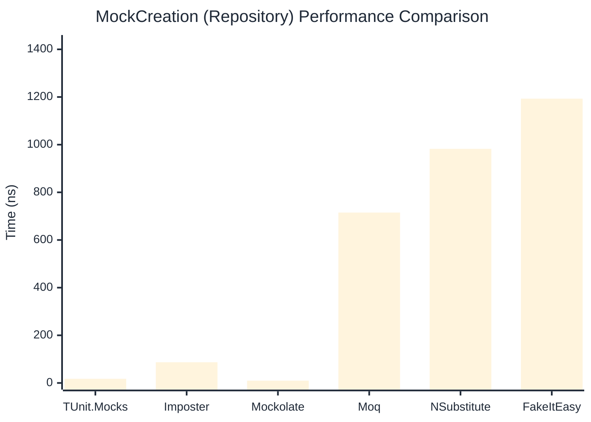

# MockCreation Benchmark

> Mock instance creation performance — comparing **TUnit.Mocks** (source-generated) against runtime proxy-based mocking libraries.

:::info Last Updated
This benchmark was automatically generated on **2026-10-16** from the latest CI run.

**Environment:** Ubuntu Latest • .NET SDK 10.0.402
:::

## 📊 Results

Mock instance creation performance:

| Library | Mean | Error | StdDev | Allocated |
|---------|------|-------|--------|-----------|
| **TUnit.Mocks** | 17.251 ns | 0.3557 ns | 0.5323 ns | 216 B |
| Imposter | 59.016 ns | 1.1980 ns | 1.5577 ns | 432 B |
| Mockolate | 10.049 ns | 0.2393 ns | 0.2560 ns | 160 B |
| Moq | 736.148 ns | 14.6709 ns | 13.7232 ns | 2048 B |
| NSubstitute | 972.222 ns | 17.1789 ns | 19.0943 ns | 5000 B |
| FakeItEasy | 1,058.376 ns | 15.8168 ns | 14.7950 ns | 2714 B |

---

### Repository

| Library | Mean | Error | StdDev | Allocated |
|---------|------|-------|--------|-----------|
| **TUnit.Mocks** | 17.512 ns | 0.2507 ns | 0.2345 ns | 216 B |
| Imposter | 87.007 ns | 1.6923 ns | 2.1403 ns | 688 B |
| Mockolate | 9.808 ns | 0.1331 ns | 0.1245 ns | 176 B |
| Moq | 715.143 ns | 13.5720 ns | 13.3295 ns | 1912 B |
| NSubstitute | 982.563 ns | 10.6403 ns | 9.9529 ns | 5000 B |
| FakeItEasy | 1,193.154 ns | 23.6920 ns | 36.1802 ns | 2714 B |

## 🎯 Key Insights

This benchmark compares **TUnit.Mocks** (source-generated) against runtime proxy-based mocking libraries for mock instance creation performance.

---

:::note Methodology
View the [mock benchmarks overview](/docs/benchmarks/mocks) for methodology details and environment information.
:::

*Last generated: 2026-10-16T03:11:30.127Z*
