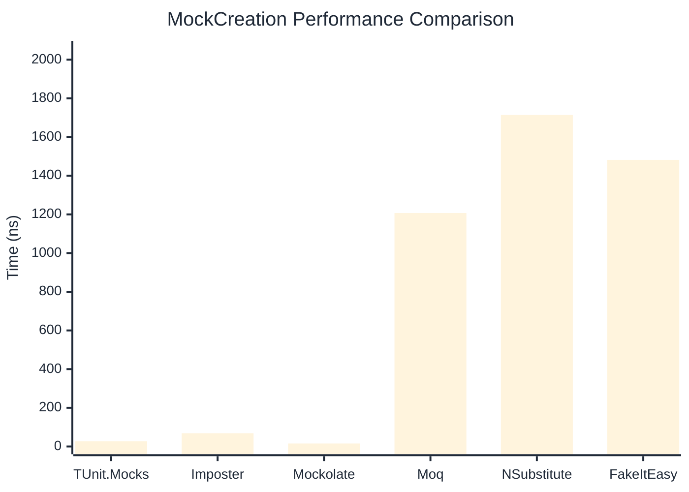

# MockCreation Benchmark

> Mock instance creation performance — comparing **TUnit.Mocks** (source-generated) against runtime proxy-based mocking libraries.

:::info Last Updated
This benchmark was automatically generated on **2026-11-16** from the latest CI run.

**Environment:** Ubuntu Latest • .NET SDK 11.0.100
:::

## 📊 Results

Mock instance creation performance:

| Library | Mean | Error | StdDev | Allocated |
|---------|------|-------|--------|-----------|
| **TUnit.Mocks** | 26.60 ns | 0.353 ns | 0.330 ns | 216 B |
| Imposter | 68.65 ns | 0.287 ns | 0.255 ns | 360 B |
| Mockolate | 15.44 ns | 0.122 ns | 0.108 ns | 160 B |
| Moq | 1,207.00 ns | 16.829 ns | 14.918 ns | 2040 B |
| NSubstitute | 1,713.99 ns | 11.456 ns | 10.155 ns | 4984 B |
| FakeItEasy | 1,481.93 ns | 13.220 ns | 11.720 ns | 2706 B |

---

### Repository

| Library | Mean | Error | StdDev | Allocated |
|---------|------|-------|--------|-----------|
| **TUnit.Mocks** | 26.51 ns | 0.525 ns | 0.466 ns | 216 B |
| Imposter | 105.22 ns | 1.125 ns | 1.052 ns | 568 B |
| Mockolate | 16.30 ns | 0.320 ns | 0.329 ns | 176 B |
| Moq | 1,205.10 ns | 7.549 ns | 6.304 ns | 1904 B |
| NSubstitute | 1,693.21 ns | 13.187 ns | 11.690 ns | 4984 B |
| FakeItEasy | 1,480.48 ns | 12.118 ns | 11.336 ns | 2706 B |

## 🎯 Key Insights

This benchmark compares **TUnit.Mocks** (source-generated) against runtime proxy-based mocking libraries for mock instance creation performance.

---

:::note Methodology
View the [mock benchmarks overview](/docs/benchmarks/mocks) for methodology details and environment information.
:::

*Last generated: 2026-11-16T02:25:25.447Z*
