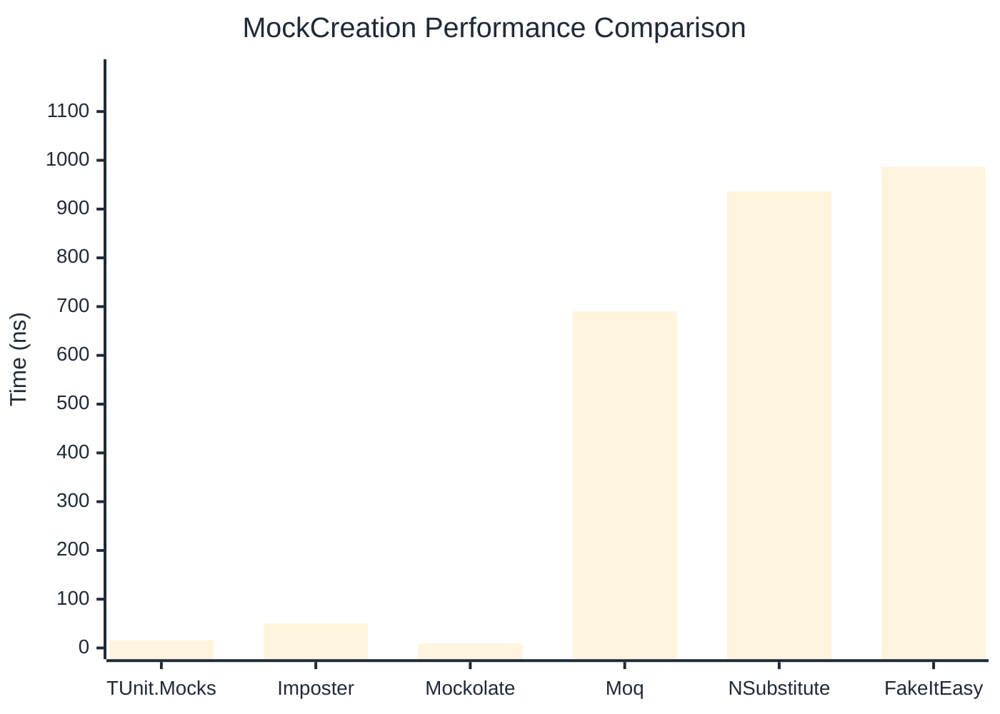
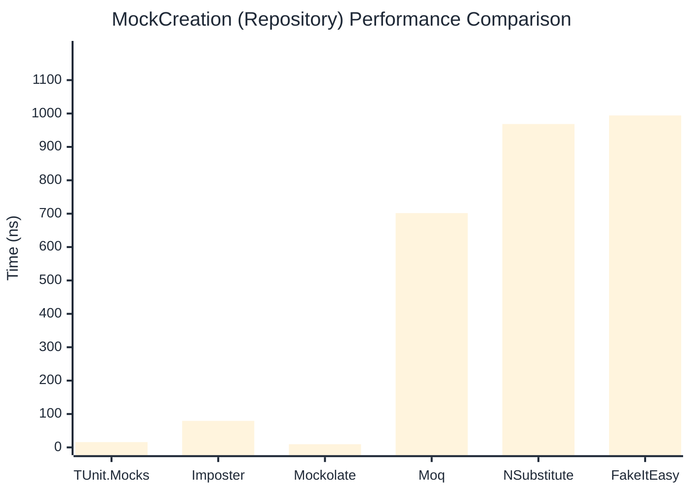

# MockCreation Benchmark

> Mock instance creation performance — comparing **TUnit.Mocks** (source-generated) against runtime proxy-based mocking libraries.

:::info Last Updated
This benchmark was automatically generated on **2026-10-11** from the latest CI run.

**Environment:** Ubuntu Latest • .NET SDK 10.0.401
:::

## 📊 Results

Mock instance creation performance:

| Library | Mean | Error | StdDev | Allocated |
|---------|------|-------|--------|-----------|
| **TUnit.Mocks** | 15.547 ns | 0.2415 ns | 0.2259 ns | 200 B |
| Imposter | 50.740 ns | 0.2938 ns | 0.2604 ns | 432 B |
| Mockolate | 9.138 ns | 0.1372 ns | 0.1216 ns | 160 B |
| Moq | 690.357 ns | 4.0596 ns | 3.5987 ns | 2048 B |
| NSubstitute | 936.128 ns | 6.9322 ns | 6.1452 ns | 5000 B |
| FakeItEasy | 986.398 ns | 6.5500 ns | 5.8064 ns | 2714 B |

---

### Repository

| Library | Mean | Error | StdDev | Allocated |
|---------|------|-------|--------|-----------|
| **TUnit.Mocks** | 15.867 ns | 0.2746 ns | 0.2568 ns | 200 B |
| Imposter | 79.456 ns | 0.6010 ns | 0.5327 ns | 688 B |
| Mockolate | 9.481 ns | 0.1404 ns | 0.1313 ns | 176 B |
| Moq | 701.746 ns | 11.2995 ns | 10.5696 ns | 1912 B |
| NSubstitute | 968.470 ns | 5.5372 ns | 5.1795 ns | 5000 B |
| FakeItEasy | 994.231 ns | 7.0344 ns | 6.5799 ns | 2714 B |

## 🎯 Key Insights

This benchmark compares **TUnit.Mocks** (source-generated) against runtime proxy-based mocking libraries for mock instance creation performance.

---

:::note Methodology
View the [mock benchmarks overview](/docs/benchmarks/mocks) for methodology details and environment information.
:::

*Last generated: 2026-10-11T02:43:35.245Z*
