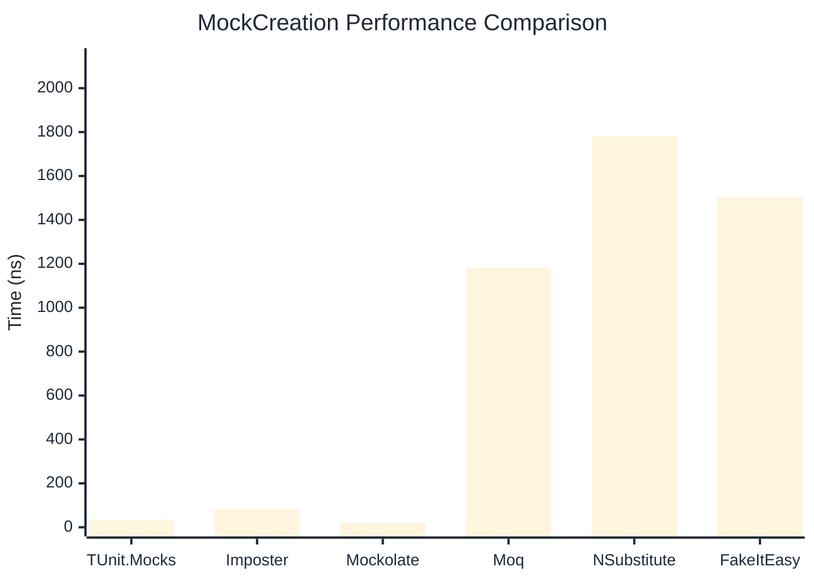

# MockCreation Benchmark

> Mock instance creation performance — comparing **TUnit.Mocks** (source-generated) against runtime proxy-based mocking libraries.

:::info Last Updated
This benchmark was automatically generated on **2026-11-12** from the latest CI run.

**Environment:** Ubuntu Latest • .NET SDK 11.0.100
:::

## 📊 Results

Mock instance creation performance:

| Library | Mean | Error | StdDev | Allocated |
|---------|------|-------|--------|-----------|
| **TUnit.Mocks** | 30.68 ns | 0.597 ns | 0.586 ns | 216 B |
| Imposter | 80.68 ns | 1.393 ns | 1.303 ns | 360 B |
| Mockolate | 17.98 ns | 0.318 ns | 0.297 ns | 160 B |
| Moq | 1,180.14 ns | 12.085 ns | 10.713 ns | 2040 B |
| NSubstitute | 1,782.99 ns | 23.622 ns | 22.096 ns | 4984 B |
| FakeItEasy | 1,501.09 ns | 13.291 ns | 12.432 ns | 2715 B |

---

### Repository

| Library | Mean | Error | StdDev | Allocated |
|---------|------|-------|--------|-----------|
| **TUnit.Mocks** | 31.47 ns | 0.590 ns | 0.952 ns | 216 B |
| Imposter | 122.95 ns | 1.996 ns | 1.867 ns | 568 B |
| Mockolate | 19.20 ns | 0.354 ns | 0.407 ns | 176 B |
| Moq | 1,183.24 ns | 9.702 ns | 9.075 ns | 1904 B |
| NSubstitute | 1,788.80 ns | 8.713 ns | 7.724 ns | 4984 B |
| FakeItEasy | 1,525.93 ns | 12.245 ns | 11.454 ns | 2715 B |

## 🎯 Key Insights

This benchmark compares **TUnit.Mocks** (source-generated) against runtime proxy-based mocking libraries for mock instance creation performance.

---

:::note Methodology
View the [mock benchmarks overview](/docs/benchmarks/mocks) for methodology details and environment information.
:::

*Last generated: 2026-11-12T02:21:42.541Z*
