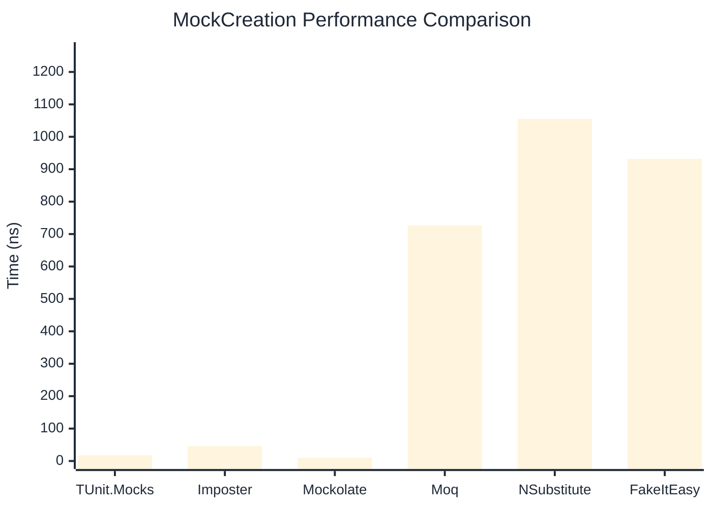

# MockCreation Benchmark

> Mock instance creation performance — comparing **TUnit.Mocks** (source-generated) against runtime proxy-based mocking libraries.

:::info Last Updated
This benchmark was automatically generated on **2026-11-14** from the latest CI run.

**Environment:** Ubuntu Latest • .NET SDK 11.0.100
:::

## 📊 Results

Mock instance creation performance:

| Library | Mean | Error | StdDev | Allocated |
|---------|------|-------|--------|-----------|
| **TUnit.Mocks** | 17.13 ns | 0.182 ns | 0.142 ns | 216 B |
| Imposter | 46.11 ns | 0.844 ns | 1.210 ns | 360 B |
| Mockolate | 10.17 ns | 0.185 ns | 0.173 ns | 160 B |
| Moq | 726.25 ns | 13.735 ns | 12.847 ns | 2040 B |
| NSubstitute | 1,055.43 ns | 21.527 ns | 63.134 ns | 4984 B |
| FakeItEasy | 931.99 ns | 9.954 ns | 9.311 ns | 2706 B |

---

### Repository

| Library | Mean | Error | StdDev | Allocated |
|---------|------|-------|--------|-----------|
| **TUnit.Mocks** | 18.70 ns | 0.276 ns | 0.230 ns | 216 B |
| Imposter | 73.46 ns | 1.443 ns | 1.717 ns | 568 B |
| Mockolate | 11.32 ns | 0.191 ns | 0.169 ns | 176 B |
| Moq | 783.74 ns | 11.327 ns | 10.041 ns | 1904 B |
| NSubstitute | 1,117.05 ns | 15.015 ns | 13.310 ns | 4984 B |
| FakeItEasy | 987.24 ns | 18.987 ns | 17.760 ns | 2706 B |

## 🎯 Key Insights

This benchmark compares **TUnit.Mocks** (source-generated) against runtime proxy-based mocking libraries for mock instance creation performance.

---

:::note Methodology
View the [mock benchmarks overview](/docs/benchmarks/mocks) for methodology details and environment information.
:::

*Last generated: 2026-11-14T02:21:36.343Z*
