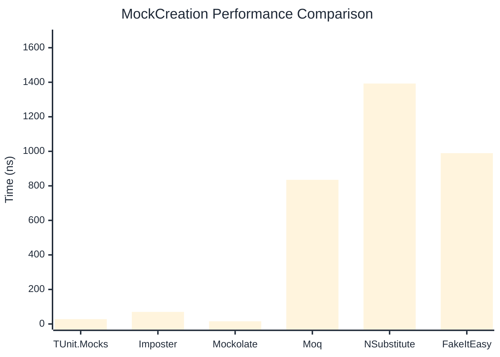
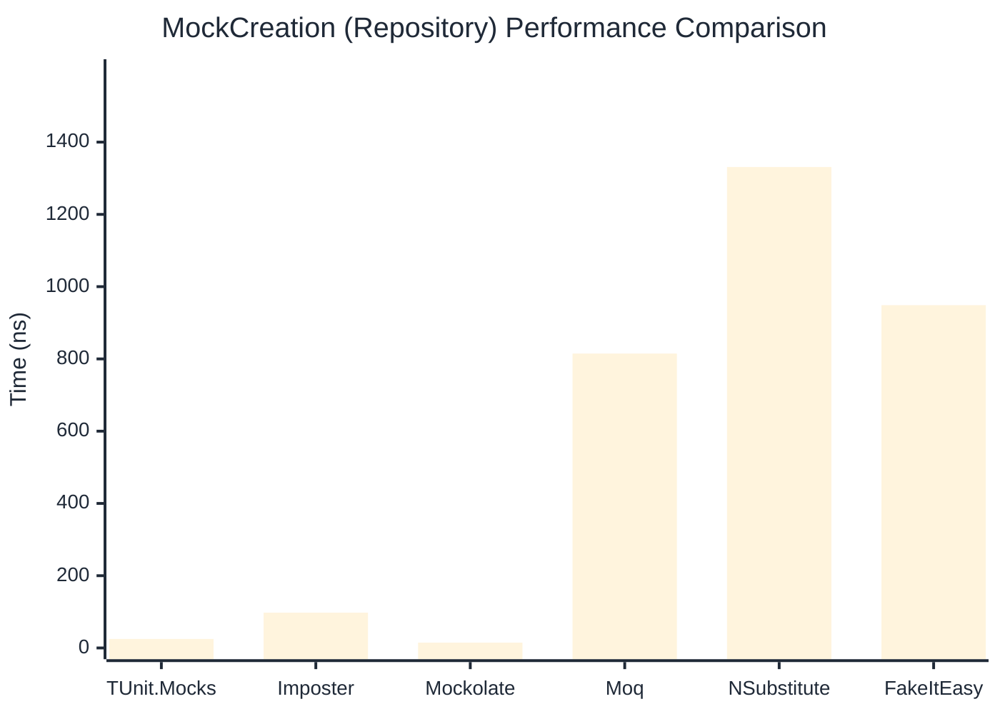

# MockCreation Benchmark

> Mock instance creation performance — comparing **TUnit.Mocks** (source-generated) against runtime proxy-based mocking libraries.

:::info Last Updated
This benchmark was automatically generated on **2026-11-17** from the latest CI run.

**Environment:** Ubuntu Latest • .NET SDK 11.0.100
:::

## 📊 Results

Mock instance creation performance:

| Library | Mean | Error | StdDev | Allocated |
|---------|------|-------|--------|-----------|
| **TUnit.Mocks** | 28.05 ns | 0.749 ns | 2.207 ns | 216 B |
| Imposter | 69.94 ns | 1.526 ns | 4.501 ns | 360 B |
| Mockolate | 15.53 ns | 0.479 ns | 1.413 ns | 160 B |
| Moq | 834.89 ns | 2.947 ns | 2.461 ns | 2040 B |
| NSubstitute | 1,392.60 ns | 18.474 ns | 16.377 ns | 4984 B |
| FakeItEasy | 989.40 ns | 19.674 ns | 30.631 ns | 2701 B |

---

### Repository

| Library | Mean | Error | StdDev | Allocated |
|---------|------|-------|--------|-----------|
| **TUnit.Mocks** | 24.87 ns | 0.496 ns | 0.572 ns | 216 B |
| Imposter | 97.70 ns | 1.935 ns | 5.394 ns | 568 B |
| Mockolate | 14.69 ns | 0.289 ns | 0.491 ns | 176 B |
| Moq | 814.83 ns | 12.519 ns | 11.710 ns | 1904 B |
| NSubstitute | 1,331.13 ns | 26.356 ns | 38.633 ns | 4984 B |
| FakeItEasy | 948.71 ns | 18.432 ns | 17.242 ns | 2701 B |

## 🎯 Key Insights

This benchmark compares **TUnit.Mocks** (source-generated) against runtime proxy-based mocking libraries for mock instance creation performance.

---

:::note Methodology
View the [mock benchmarks overview](/docs/benchmarks/mocks) for methodology details and environment information.
:::

*Last generated: 2026-11-17T02:23:59.645Z*
