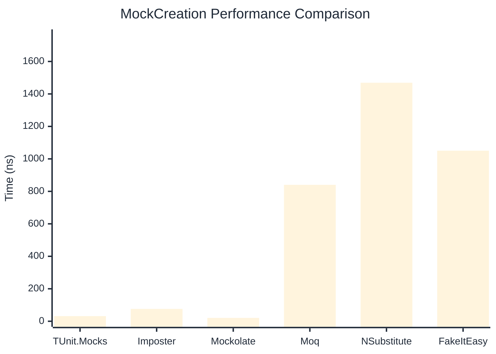
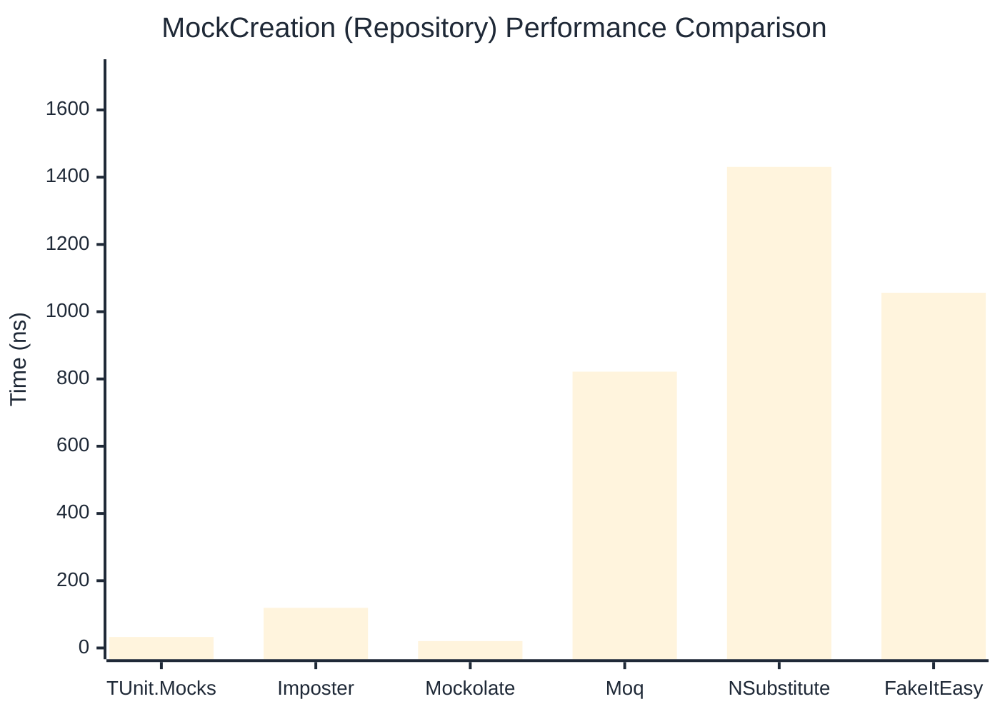

# MockCreation Benchmark

> Mock instance creation performance — comparing **TUnit.Mocks** (source-generated) against runtime proxy-based mocking libraries.

:::info Last Updated
This benchmark was automatically generated on **2026-11-19** from the latest CI run.

**Environment:** Ubuntu Latest • .NET SDK 11.0.100
:::

## 📊 Results

Mock instance creation performance:

| Library | Mean | Error | StdDev | Allocated |
|---------|------|-------|--------|-----------|
| **TUnit.Mocks** | 31.72 ns | 0.820 ns | 2.417 ns | 216 B |
| Imposter | 76.10 ns | 1.129 ns | 1.001 ns | 360 B |
| Mockolate | 20.82 ns | 0.408 ns | 0.725 ns | 160 B |
| Moq | 840.19 ns | 6.742 ns | 6.306 ns | 2040 B |
| NSubstitute | 1,469.05 ns | 6.733 ns | 5.968 ns | 4984 B |
| FakeItEasy | 1,050.43 ns | 12.472 ns | 11.667 ns | 2701 B |

---

### Repository

| Library | Mean | Error | StdDev | Allocated |
|---------|------|-------|--------|-----------|
| **TUnit.Mocks** | 32.69 ns | 0.653 ns | 1.625 ns | 216 B |
| Imposter | 119.33 ns | 2.375 ns | 2.439 ns | 568 B |
| Mockolate | 20.36 ns | 0.608 ns | 1.792 ns | 176 B |
| Moq | 821.66 ns | 2.381 ns | 2.111 ns | 1904 B |
| NSubstitute | 1,430.57 ns | 28.056 ns | 27.555 ns | 4984 B |
| FakeItEasy | 1,056.41 ns | 18.728 ns | 17.518 ns | 2701 B |

## 🎯 Key Insights

This benchmark compares **TUnit.Mocks** (source-generated) against runtime proxy-based mocking libraries for mock instance creation performance.

---

:::note Methodology
View the [mock benchmarks overview](/docs/benchmarks/mocks) for methodology details and environment information.
:::

*Last generated: 2026-11-19T02:23:19.275Z*
