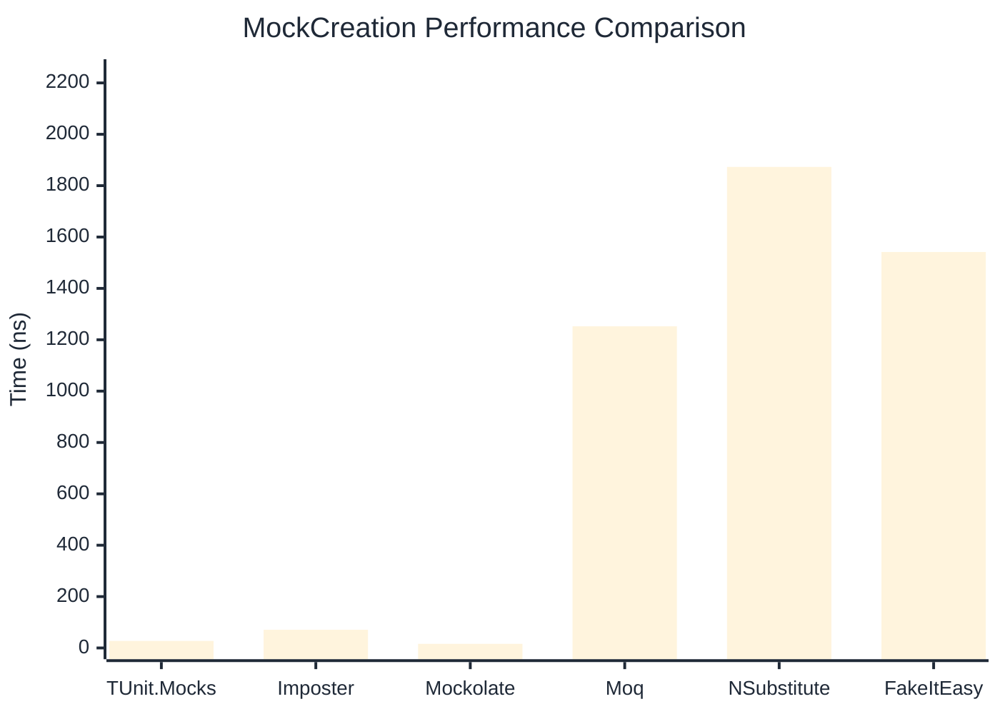
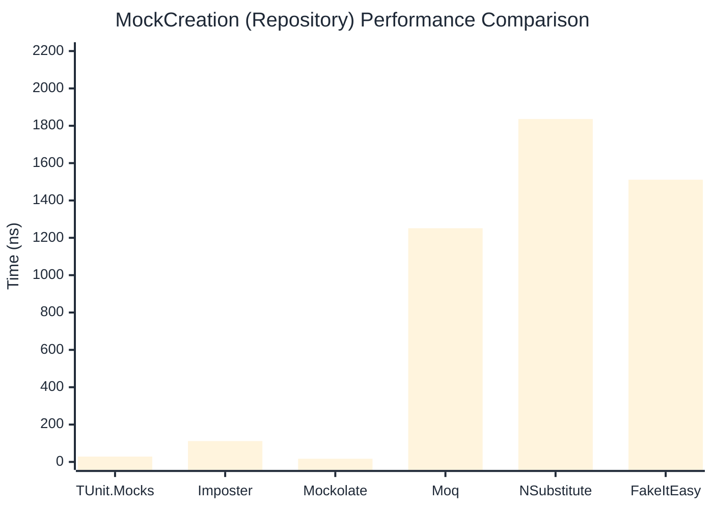

# MockCreation Benchmark

> Mock instance creation performance — comparing **TUnit.Mocks** (source-generated) against runtime proxy-based mocking libraries.

:::info Last Updated
This benchmark was automatically generated on **2026-11-15** from the latest CI run.

**Environment:** Ubuntu Latest • .NET SDK 11.0.100
:::

## 📊 Results

Mock instance creation performance:

| Library | Mean | Error | StdDev | Allocated |
|---------|------|-------|--------|-----------|
| **TUnit.Mocks** | 27.37 ns | 0.538 ns | 0.772 ns | 216 B |
| Imposter | 70.91 ns | 0.898 ns | 0.796 ns | 360 B |
| Mockolate | 16.08 ns | 0.314 ns | 0.308 ns | 160 B |
| Moq | 1,252.38 ns | 19.017 ns | 17.789 ns | 2040 B |
| NSubstitute | 1,873.00 ns | 33.410 ns | 31.251 ns | 4984 B |
| FakeItEasy | 1,541.66 ns | 23.826 ns | 22.287 ns | 2706 B |

---

### Repository

| Library | Mean | Error | StdDev | Allocated |
|---------|------|-------|--------|-----------|
| **TUnit.Mocks** | 28.60 ns | 0.563 ns | 0.526 ns | 216 B |
| Imposter | 111.76 ns | 2.107 ns | 2.069 ns | 568 B |
| Mockolate | 17.05 ns | 0.339 ns | 0.856 ns | 176 B |
| Moq | 1,251.33 ns | 12.158 ns | 11.373 ns | 1904 B |
| NSubstitute | 1,836.13 ns | 19.923 ns | 17.662 ns | 4984 B |
| FakeItEasy | 1,511.16 ns | 29.013 ns | 25.719 ns | 2706 B |

## 🎯 Key Insights

This benchmark compares **TUnit.Mocks** (source-generated) against runtime proxy-based mocking libraries for mock instance creation performance.

---

:::note Methodology
View the [mock benchmarks overview](/docs/benchmarks/mocks) for methodology details and environment information.
:::

*Last generated: 2026-11-15T02:24:17.223Z*
