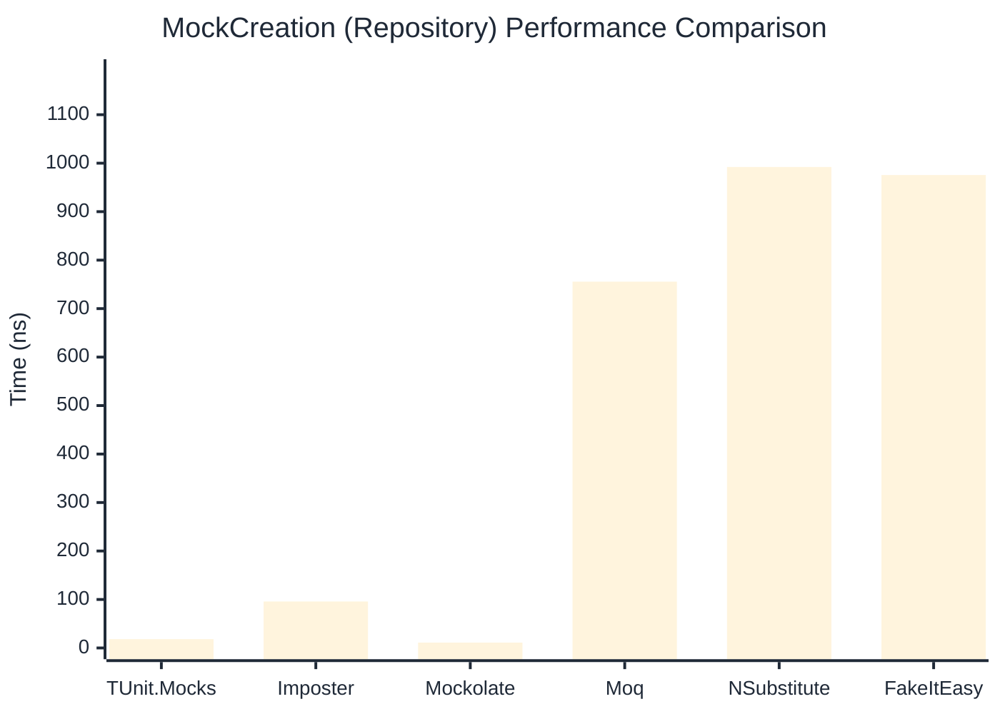

# MockCreation Benchmark

> Mock instance creation performance — comparing **TUnit.Mocks** (source-generated) against runtime proxy-based mocking libraries.

:::info Last Updated
This benchmark was automatically generated on **2026-10-25** from the latest CI run.

**Environment:** Ubuntu Latest • .NET SDK 10.0.402
:::

## 📊 Results

Mock instance creation performance:

| Library | Mean | Error | StdDev | Allocated |
|---------|------|-------|--------|-----------|
| **TUnit.Mocks** | 19.05 ns | 0.251 ns | 0.196 ns | 216 B |
| Imposter | 62.21 ns | 1.019 ns | 0.851 ns | 432 B |
| Mockolate | 11.09 ns | 0.264 ns | 0.315 ns | 160 B |
| Moq | 799.89 ns | 16.024 ns | 17.145 ns | 2048 B |
| NSubstitute | 1,031.84 ns | 19.194 ns | 23.571 ns | 5000 B |
| FakeItEasy | 999.67 ns | 9.303 ns | 8.247 ns | 2715 B |

---

### Repository

| Library | Mean | Error | StdDev | Allocated |
|---------|------|-------|--------|-----------|
| **TUnit.Mocks** | 18.16 ns | 0.281 ns | 0.235 ns | 216 B |
| Imposter | 95.84 ns | 1.730 ns | 2.188 ns | 688 B |
| Mockolate | 11.06 ns | 0.251 ns | 0.368 ns | 176 B |
| Moq | 755.66 ns | 14.982 ns | 14.015 ns | 1912 B |
| NSubstitute | 992.14 ns | 15.045 ns | 13.337 ns | 5000 B |
| FakeItEasy | 975.57 ns | 12.802 ns | 11.349 ns | 2715 B |

## 🎯 Key Insights

This benchmark compares **TUnit.Mocks** (source-generated) against runtime proxy-based mocking libraries for mock instance creation performance.

---

:::note Methodology
View the [mock benchmarks overview](/docs/benchmarks/mocks) for methodology details and environment information.
:::

*Last generated: 2026-10-25T02:33:24.276Z*
