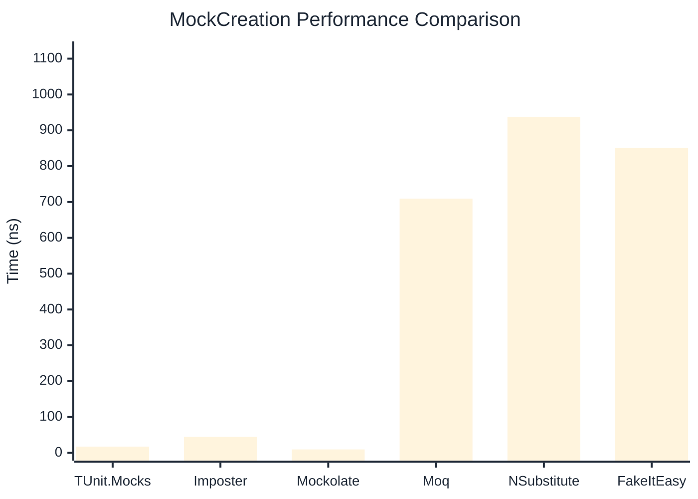
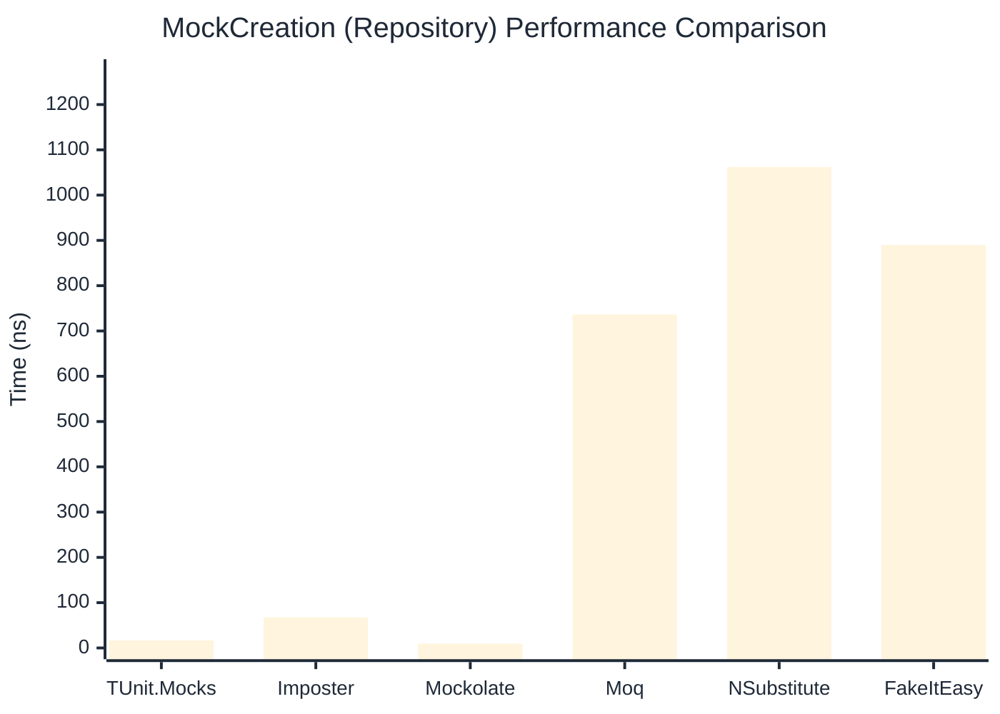

# MockCreation Benchmark

> Mock instance creation performance — comparing **TUnit.Mocks** (source-generated) against other source-generated and runtime proxy-based mocking libraries.

:::info Last Updated
This benchmark was automatically generated on **2026-11-20** from the latest CI run.

**Environment:** Ubuntu Latest • .NET SDK 11.0.100
:::

## 📊 Results

Mock instance creation performance:

| Library | Mean | Error | StdDev | Allocated |
|---------|------|-------|--------|-----------|
| **TUnit.Mocks** | 17.361 ns | 0.3426 ns | 0.4208 ns | 216 B |
| Imposter | 44.561 ns | 0.8332 ns | 1.1123 ns | 360 B |
| Mockolate | 9.573 ns | 0.1827 ns | 0.2175 ns | 136 B |
| Moq | 709.347 ns | 14.1007 ns | 28.8041 ns | 2040 B |
| NSubstitute | 937.918 ns | 14.8727 ns | 13.1842 ns | 4984 B |
| FakeItEasy | 850.538 ns | 14.1140 ns | 11.7859 ns | 2706 B |

---

### Repository

| Library | Mean | Error | StdDev | Allocated |
|---------|------|-------|--------|-----------|
| **TUnit.Mocks** | 16.803 ns | 0.3197 ns | 0.2991 ns | 216 B |
| Imposter | 67.512 ns | 1.1719 ns | 1.0389 ns | 568 B |
| Mockolate | 9.571 ns | 0.1877 ns | 0.1843 ns | 136 B |
| Moq | 736.449 ns | 14.3440 ns | 22.7511 ns | 1904 B |
| NSubstitute | 1,062.061 ns | 21.0839 ns | 36.3686 ns | 4984 B |
| FakeItEasy | 889.600 ns | 17.6320 ns | 35.2130 ns | 2706 B |

## 🎯 Key Insights

This benchmark compares **TUnit.Mocks** (source-generated) against other source-generated and runtime proxy-based mocking libraries for mock instance creation performance.

---

:::note Methodology
View the [mock benchmarks overview](/docs/benchmarks/mocks) for methodology details and environment information.
:::

*Last generated: 2026-11-20T02:20:51.427Z*
