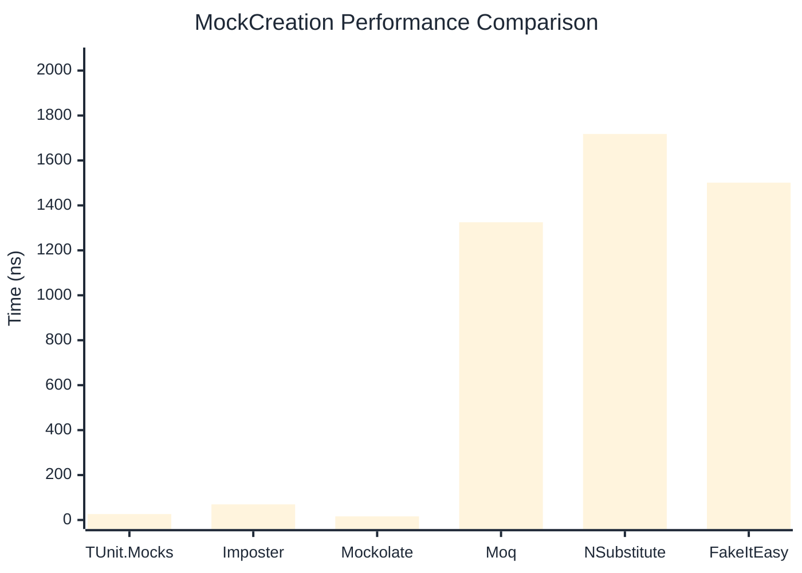
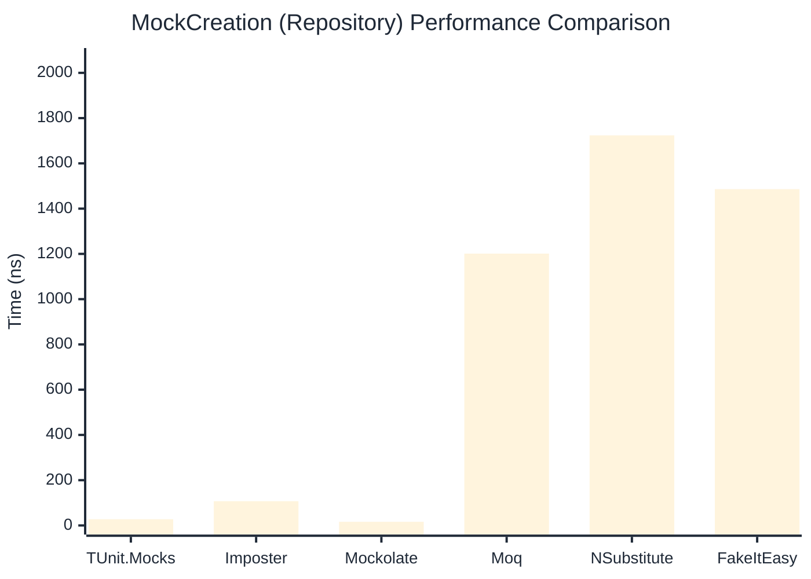

# MockCreation Benchmark

> Mock instance creation performance — comparing **TUnit.Mocks** (source-generated) against runtime proxy-based mocking libraries.

:::info Last Updated
This benchmark was automatically generated on **2026-11-13** from the latest CI run.

**Environment:** Ubuntu Latest • .NET SDK 11.0.100
:::

## 📊 Results

Mock instance creation performance:

| Library | Mean | Error | StdDev | Allocated |
|---------|------|-------|--------|-----------|
| **TUnit.Mocks** | 26.34 ns | 0.262 ns | 0.232 ns | 216 B |
| Imposter | 69.58 ns | 1.366 ns | 1.519 ns | 360 B |
| Mockolate | 16.08 ns | 0.302 ns | 0.267 ns | 160 B |
| Moq | 1,325.03 ns | 20.624 ns | 19.292 ns | 2040 B |
| NSubstitute | 1,717.95 ns | 15.300 ns | 12.776 ns | 4984 B |
| FakeItEasy | 1,501.36 ns | 18.622 ns | 17.419 ns | 2706 B |

---

### Repository

| Library | Mean | Error | StdDev | Allocated |
|---------|------|-------|--------|-----------|
| **TUnit.Mocks** | 27.53 ns | 0.429 ns | 0.401 ns | 216 B |
| Imposter | 107.13 ns | 0.964 ns | 0.902 ns | 568 B |
| Mockolate | 16.15 ns | 0.270 ns | 0.240 ns | 176 B |
| Moq | 1,201.21 ns | 8.221 ns | 7.690 ns | 1904 B |
| NSubstitute | 1,723.85 ns | 15.765 ns | 13.975 ns | 4984 B |
| FakeItEasy | 1,486.12 ns | 19.220 ns | 17.978 ns | 2706 B |

## 🎯 Key Insights

This benchmark compares **TUnit.Mocks** (source-generated) against runtime proxy-based mocking libraries for mock instance creation performance.

---

:::note Methodology
View the [mock benchmarks overview](/docs/benchmarks/mocks) for methodology details and environment information.
:::

*Last generated: 2026-11-13T02:20:37.421Z*
