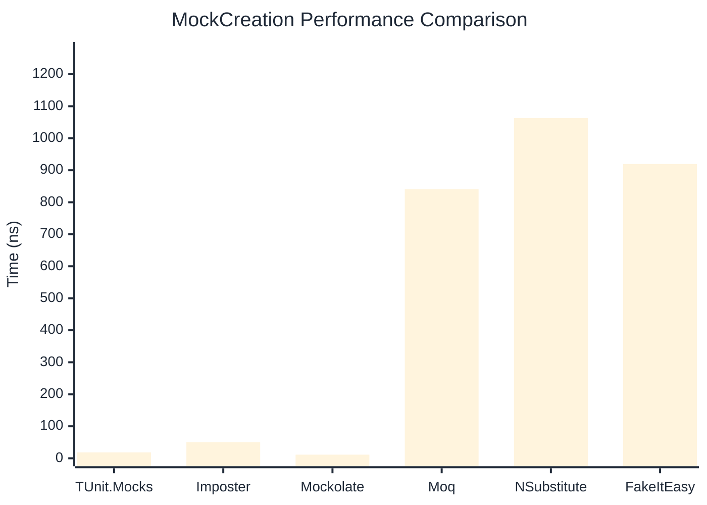

# MockCreation Benchmark

> Mock instance creation performance — comparing **TUnit.Mocks** (source-generated) against runtime proxy-based mocking libraries.

:::info Last Updated
This benchmark was automatically generated on **2026-11-11** from the latest CI run.

**Environment:** Ubuntu Latest • .NET SDK 11.0.100
:::

## 📊 Results

Mock instance creation performance:

| Library | Mean | Error | StdDev | Allocated |
|---------|------|-------|--------|-----------|
| **TUnit.Mocks** | 18.56 ns | 0.336 ns | 0.314 ns | 216 B |
| Imposter | 50.56 ns | 1.000 ns | 1.974 ns | 360 B |
| Mockolate | 11.31 ns | 0.143 ns | 0.120 ns | 160 B |
| Moq | 841.12 ns | 16.563 ns | 15.493 ns | 2040 B |
| NSubstitute | 1,062.91 ns | 20.484 ns | 27.346 ns | 4984 B |
| FakeItEasy | 919.59 ns | 10.641 ns | 8.886 ns | 2706 B |

---

### Repository

| Library | Mean | Error | StdDev | Allocated |
|---------|------|-------|--------|-----------|
| **TUnit.Mocks** | 17.51 ns | 0.201 ns | 0.178 ns | 216 B |
| Imposter | 70.92 ns | 1.330 ns | 1.908 ns | 568 B |
| Mockolate | 10.98 ns | 0.179 ns | 0.159 ns | 176 B |
| Moq | 782.30 ns | 7.974 ns | 7.068 ns | 1904 B |
| NSubstitute | 1,082.51 ns | 21.168 ns | 28.258 ns | 4984 B |
| FakeItEasy | 936.88 ns | 18.646 ns | 24.245 ns | 2706 B |

## 🎯 Key Insights

This benchmark compares **TUnit.Mocks** (source-generated) against runtime proxy-based mocking libraries for mock instance creation performance.

---

:::note Methodology
View the [mock benchmarks overview](/docs/benchmarks/mocks) for methodology details and environment information.
:::

*Last generated: 2026-11-11T02:20:11.802Z*
