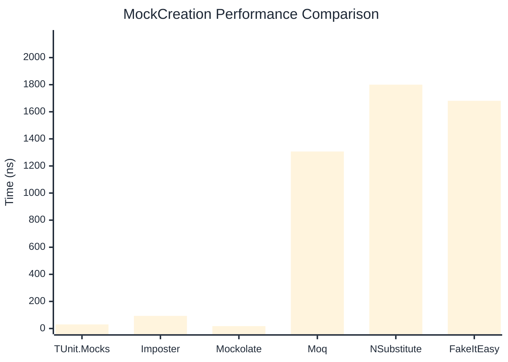
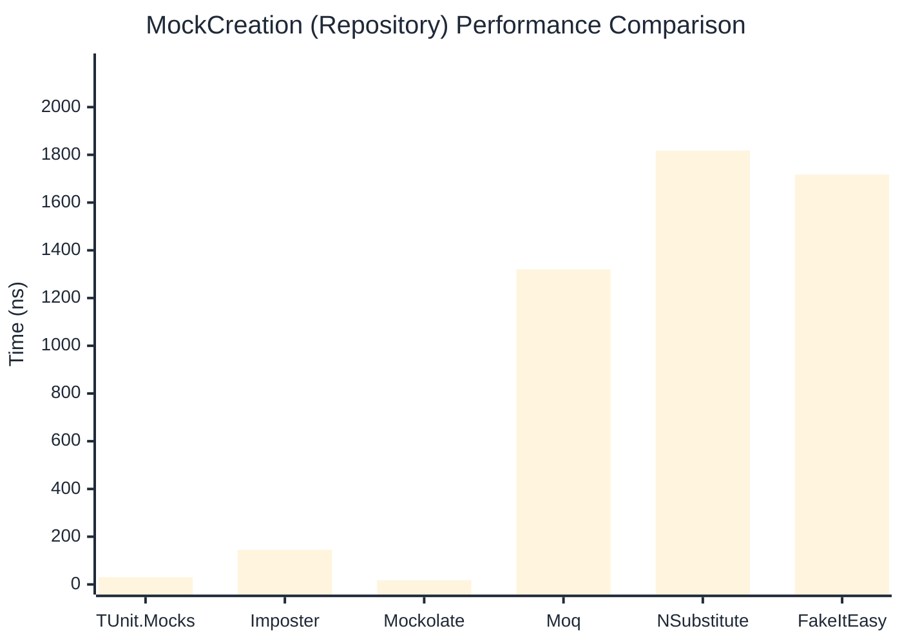

# MockCreation Benchmark

> Mock instance creation performance — comparing **TUnit.Mocks** (source-generated) against runtime proxy-based mocking libraries.

:::info Last Updated
This benchmark was automatically generated on **2026-10-22** from the latest CI run.

**Environment:** Ubuntu Latest • .NET SDK 10.0.402
:::

## 📊 Results

Mock instance creation performance:

| Library | Mean | Error | StdDev | Allocated |
|---------|------|-------|--------|-----------|
| **TUnit.Mocks** | 30.27 ns | 0.667 ns | 0.978 ns | 216 B |
| Imposter | 93.46 ns | 1.182 ns | 1.106 ns | 432 B |
| Mockolate | 17.70 ns | 0.349 ns | 0.326 ns | 160 B |
| Moq | 1,306.87 ns | 25.907 ns | 32.764 ns | 2048 B |
| NSubstitute | 1,800.22 ns | 12.711 ns | 11.268 ns | 5000 B |
| FakeItEasy | 1,681.13 ns | 17.292 ns | 16.175 ns | 2715 B |

---

### Repository

| Library | Mean | Error | StdDev | Allocated |
|---------|------|-------|--------|-----------|
| **TUnit.Mocks** | 29.76 ns | 0.637 ns | 1.082 ns | 216 B |
| Imposter | 144.86 ns | 1.943 ns | 1.818 ns | 688 B |
| Mockolate | 17.73 ns | 0.255 ns | 0.251 ns | 176 B |
| Moq | 1,320.17 ns | 17.115 ns | 16.009 ns | 1912 B |
| NSubstitute | 1,817.76 ns | 21.607 ns | 20.211 ns | 5000 B |
| FakeItEasy | 1,717.11 ns | 26.915 ns | 28.799 ns | 2715 B |

## 🎯 Key Insights

This benchmark compares **TUnit.Mocks** (source-generated) against runtime proxy-based mocking libraries for mock instance creation performance.

---

:::note Methodology
View the [mock benchmarks overview](/docs/benchmarks/mocks) for methodology details and environment information.
:::

*Last generated: 2026-10-22T02:34:37.393Z*
