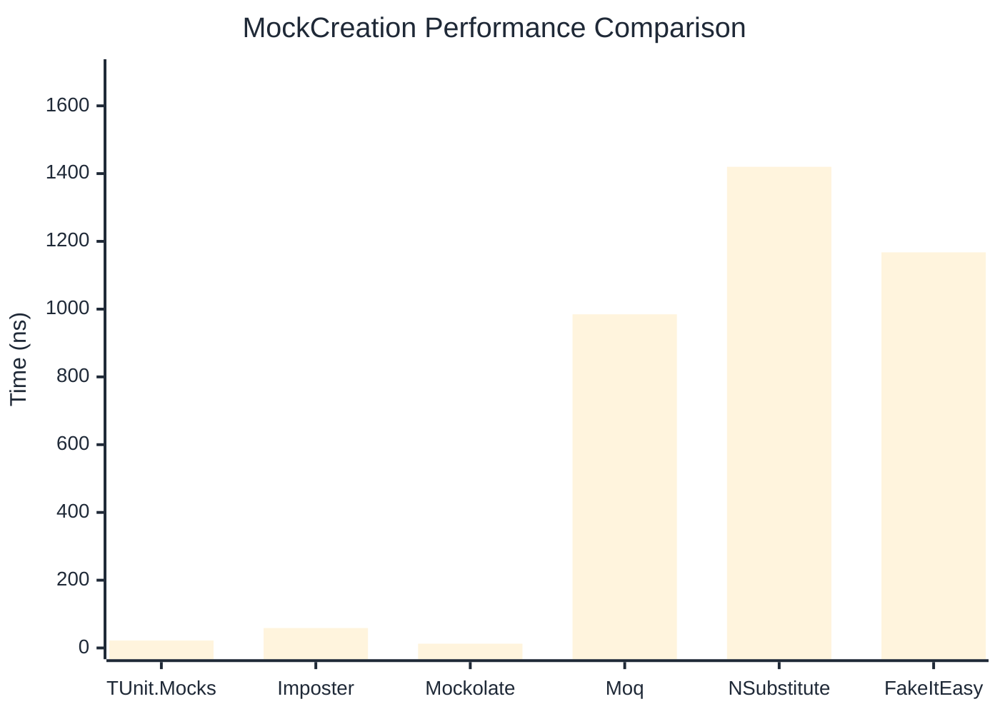

# MockCreation Benchmark

> Mock instance creation performance — comparing **TUnit.Mocks** (source-generated) against other source-generated and runtime proxy-based mocking libraries.

:::info Last Updated
This benchmark was automatically generated on **2026-11-22** from the latest CI run.

**Environment:** Ubuntu Latest • .NET SDK 11.0.100
:::

## 📊 Results

Mock instance creation performance:

| Library | Mean | Error | StdDev | Allocated |
|---------|------|-------|--------|-----------|
| **TUnit.Mocks** | 21.90 ns | 0.411 ns | 0.440 ns | 216 B |
| Imposter | 58.79 ns | 0.204 ns | 0.171 ns | 360 B |
| Mockolate | 12.59 ns | 0.091 ns | 0.076 ns | 136 B |
| Moq | 984.74 ns | 19.131 ns | 19.646 ns | 2040 B |
| NSubstitute | 1,419.98 ns | 13.831 ns | 11.549 ns | 4984 B |
| FakeItEasy | 1,167.56 ns | 23.120 ns | 46.173 ns | 2706 B |

---

### Repository

| Library | Mean | Error | StdDev | Allocated |
|---------|------|-------|--------|-----------|
| **TUnit.Mocks** | 22.20 ns | 0.111 ns | 0.093 ns | 216 B |
| Imposter | 98.83 ns | 0.560 ns | 0.468 ns | 568 B |
| Mockolate | 13.67 ns | 0.186 ns | 0.164 ns | 136 B |
| Moq | 952.83 ns | 17.691 ns | 17.375 ns | 1904 B |
| NSubstitute | 1,274.80 ns | 15.792 ns | 13.999 ns | 4984 B |
| FakeItEasy | 1,094.93 ns | 8.797 ns | 7.346 ns | 2706 B |

## 🎯 Key Insights

This benchmark compares **TUnit.Mocks** (source-generated) against other source-generated and runtime proxy-based mocking libraries for mock instance creation performance.

---

:::note Methodology
View the [mock benchmarks overview](/docs/benchmarks/mocks) for methodology details and environment information.
:::

*Last generated: 2026-11-22T02:21:53.323Z*
