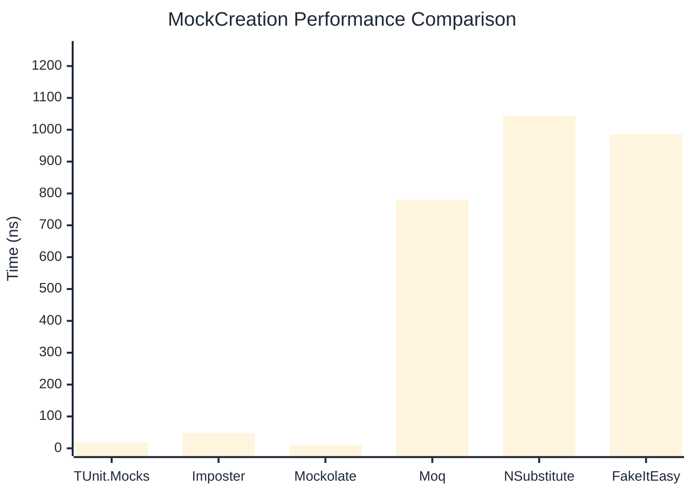
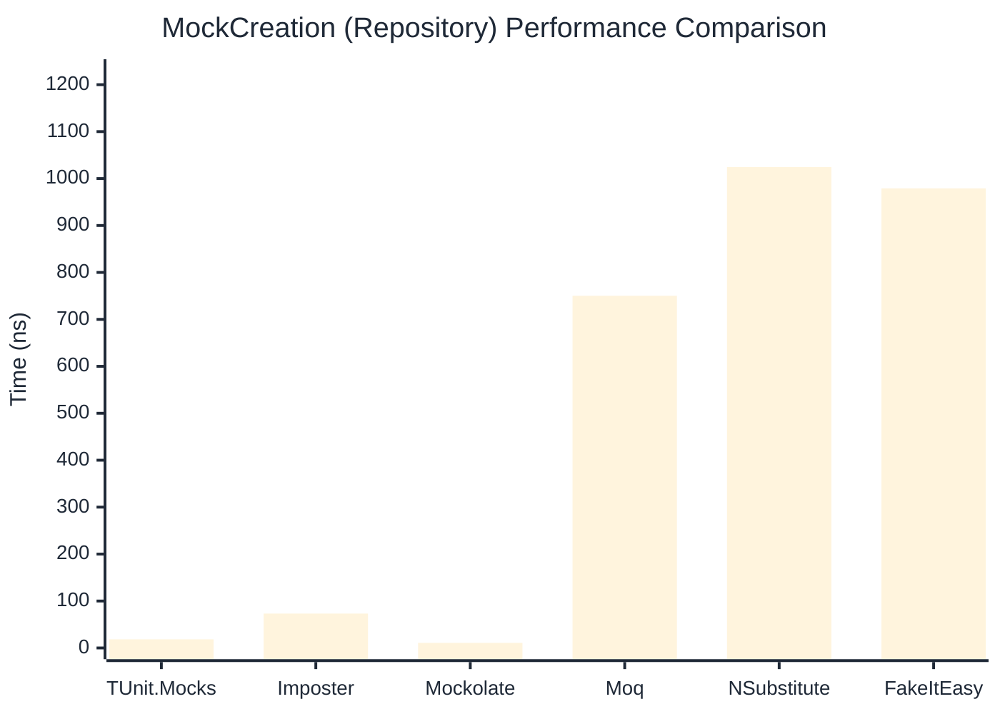

# MockCreation Benchmark

> Mock instance creation performance — comparing **TUnit.Mocks** (source-generated) against runtime proxy-based mocking libraries.

:::info Last Updated
This benchmark was automatically generated on **2026-11-06** from the latest CI run.

**Environment:** Ubuntu Latest • .NET SDK 10.0.403
:::

## 📊 Results

Mock instance creation performance:

| Library | Mean | Error | StdDev | Allocated |
|---------|------|-------|--------|-----------|
| **TUnit.Mocks** | 18.11 ns | 0.186 ns | 0.174 ns | 216 B |
| Imposter | 47.44 ns | 0.511 ns | 0.453 ns | 360 B |
| Mockolate | 10.83 ns | 0.163 ns | 0.144 ns | 160 B |
| Moq | 780.52 ns | 5.866 ns | 5.487 ns | 2048 B |
| NSubstitute | 1,044.41 ns | 11.845 ns | 10.500 ns | 5000 B |
| FakeItEasy | 985.60 ns | 18.951 ns | 21.824 ns | 2715 B |

---

### Repository

| Library | Mean | Error | StdDev | Allocated |
|---------|------|-------|--------|-----------|
| **TUnit.Mocks** | 18.37 ns | 0.402 ns | 0.550 ns | 216 B |
| Imposter | 73.25 ns | 0.504 ns | 0.447 ns | 568 B |
| Mockolate | 10.84 ns | 0.232 ns | 0.238 ns | 176 B |
| Moq | 750.33 ns | 4.722 ns | 4.417 ns | 1912 B |
| NSubstitute | 1,024.43 ns | 3.814 ns | 3.185 ns | 5000 B |
| FakeItEasy | 979.12 ns | 8.689 ns | 7.702 ns | 2715 B |

## 🎯 Key Insights

This benchmark compares **TUnit.Mocks** (source-generated) against runtime proxy-based mocking libraries for mock instance creation performance.

---

:::note Methodology
View the [mock benchmarks overview](/docs/benchmarks/mocks) for methodology details and environment information.
:::

*Last generated: 2026-11-06T02:27:23.366Z*
