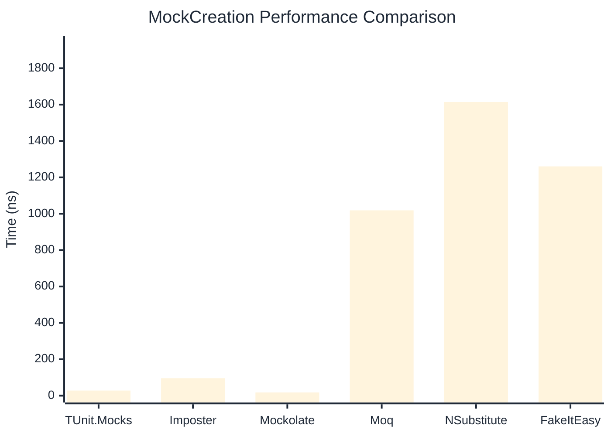
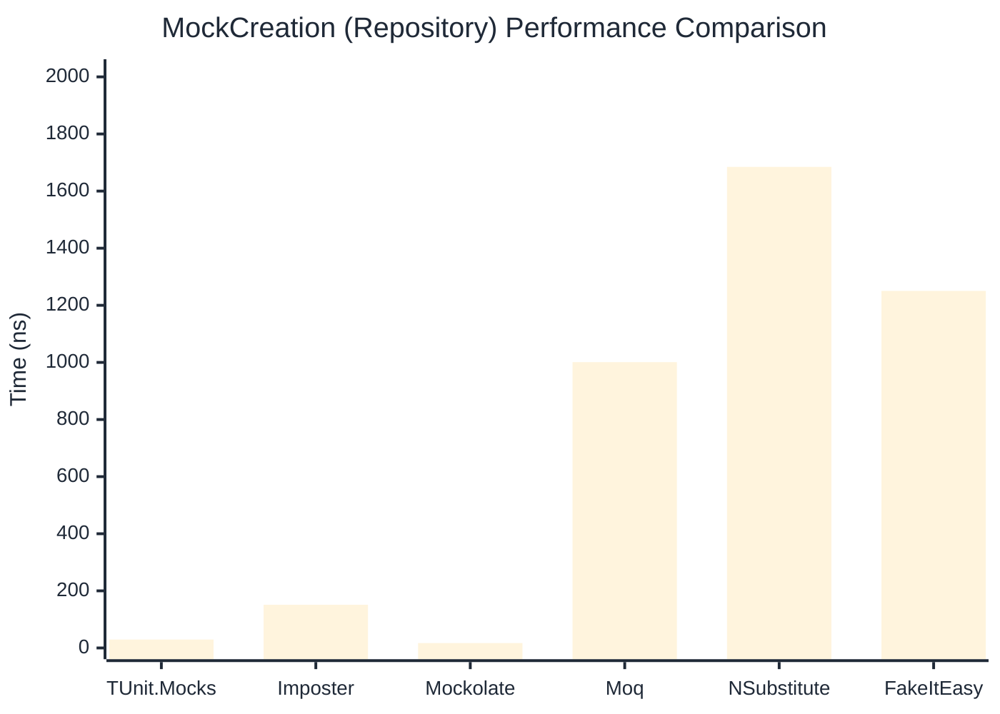

# MockCreation Benchmark

> Mock instance creation performance — comparing **TUnit.Mocks** (source-generated) against runtime proxy-based mocking libraries.

:::info Last Updated
This benchmark was automatically generated on **2026-11-01** from the latest CI run.

**Environment:** Ubuntu Latest • .NET SDK 10.0.403
:::

## 📊 Results

Mock instance creation performance:

| Library | Mean | Error | StdDev | Allocated |
|---------|------|-------|--------|-----------|
| **TUnit.Mocks** | 28.31 ns | 0.631 ns | 0.842 ns | 216 B |
| Imposter | 96.21 ns | 1.977 ns | 4.084 ns | 432 B |
| Mockolate | 17.46 ns | 0.429 ns | 1.044 ns | 160 B |
| Moq | 1,018.60 ns | 19.686 ns | 20.216 ns | 2048 B |
| NSubstitute | 1,614.23 ns | 32.154 ns | 33.020 ns | 5000 B |
| FakeItEasy | 1,260.31 ns | 19.822 ns | 18.542 ns | 2709 B |

---

### Repository

| Library | Mean | Error | StdDev | Allocated |
|---------|------|-------|--------|-----------|
| **TUnit.Mocks** | 29.52 ns | 0.667 ns | 1.435 ns | 216 B |
| Imposter | 151.23 ns | 3.051 ns | 5.878 ns | 688 B |
| Mockolate | 17.21 ns | 0.413 ns | 0.476 ns | 176 B |
| Moq | 1,000.92 ns | 6.012 ns | 5.329 ns | 1912 B |
| NSubstitute | 1,684.81 ns | 33.373 ns | 34.271 ns | 5000 B |
| FakeItEasy | 1,250.42 ns | 21.198 ns | 17.701 ns | 2709 B |

## 🎯 Key Insights

This benchmark compares **TUnit.Mocks** (source-generated) against runtime proxy-based mocking libraries for mock instance creation performance.

---

:::note Methodology
View the [mock benchmarks overview](/docs/benchmarks/mocks) for methodology details and environment information.
:::

*Last generated: 2026-11-01T02:27:32.250Z*
