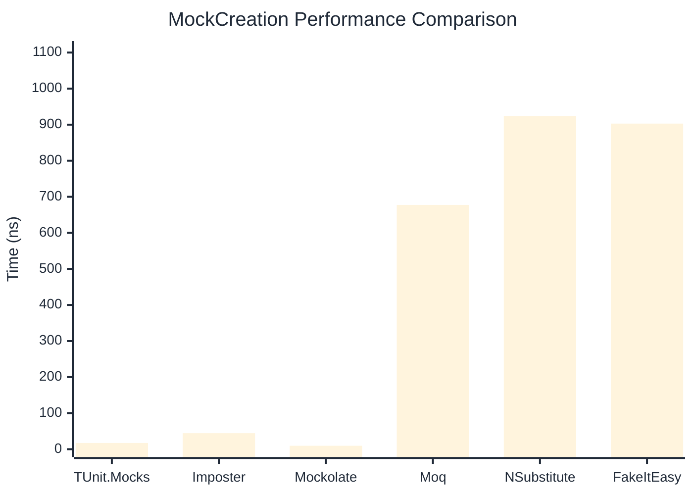

# MockCreation Benchmark

> Mock instance creation performance — comparing **TUnit.Mocks** (source-generated) against other source-generated and runtime proxy-based mocking libraries.

:::info Last Updated
This benchmark was automatically generated on **2026-11-21** from the latest CI run.

**Environment:** Ubuntu Latest • .NET SDK 11.0.100
:::

## 📊 Results

Mock instance creation performance:

| Library | Mean | Error | StdDev | Allocated |
|---------|------|-------|--------|-----------|
| **TUnit.Mocks** | 17.242 ns | 0.1355 ns | 0.1201 ns | 216 B |
| Imposter | 44.443 ns | 0.2345 ns | 0.2079 ns | 360 B |
| Mockolate | 9.552 ns | 0.1035 ns | 0.0968 ns | 136 B |
| Moq | 677.491 ns | 6.9911 ns | 6.5395 ns | 2040 B |
| NSubstitute | 924.265 ns | 16.8110 ns | 15.7250 ns | 4984 B |
| FakeItEasy | 902.947 ns | 17.9211 ns | 34.5279 ns | 2706 B |

---

### Repository

| Library | Mean | Error | StdDev | Allocated |
|---------|------|-------|--------|-----------|
| **TUnit.Mocks** | 17.608 ns | 0.2230 ns | 0.2086 ns | 216 B |
| Imposter | 71.193 ns | 0.8021 ns | 0.7110 ns | 568 B |
| Mockolate | 10.375 ns | 0.2075 ns | 0.2389 ns | 136 B |
| Moq | 739.232 ns | 5.5675 ns | 4.9355 ns | 1904 B |
| NSubstitute | 1,048.627 ns | 16.4018 ns | 15.3422 ns | 4984 B |
| FakeItEasy | 962.145 ns | 7.6987 ns | 6.8247 ns | 2706 B |

## 🎯 Key Insights

This benchmark compares **TUnit.Mocks** (source-generated) against other source-generated and runtime proxy-based mocking libraries for mock instance creation performance.

---

:::note Methodology
View the [mock benchmarks overview](/docs/benchmarks/mocks) for methodology details and environment information.
:::

*Last generated: 2026-11-21T02:20:26.016Z*
