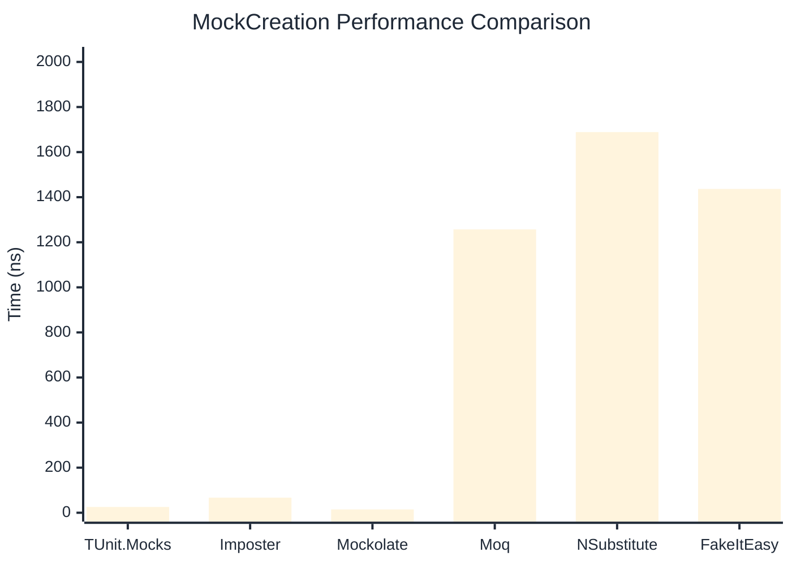

# MockCreation Benchmark

> Mock instance creation performance — comparing **TUnit.Mocks** (source-generated) against other source-generated and runtime proxy-based mocking libraries.

:::info Last Updated
This benchmark was automatically generated on **2026-11-26** from the latest CI run.

**Environment:** Ubuntu Latest • .NET SDK 11.0.100
:::

## 📊 Results

Mock instance creation performance:

| Library | Mean | Error | StdDev | Allocated |
|---------|------|-------|--------|-----------|
| **TUnit.Mocks** | 25.63 ns | 0.347 ns | 0.325 ns | 216 B |
| Imposter | 66.93 ns | 0.449 ns | 0.420 ns | 360 B |
| Mockolate | 14.66 ns | 0.086 ns | 0.076 ns | 136 B |
| Moq | 1,257.03 ns | 17.946 ns | 16.787 ns | 2040 B |
| NSubstitute | 1,688.75 ns | 4.981 ns | 4.416 ns | 4984 B |
| FakeItEasy | 1,436.53 ns | 27.987 ns | 28.741 ns | 2706 B |

---

### Repository

| Library | Mean | Error | StdDev | Allocated |
|---------|------|-------|--------|-----------|
| **TUnit.Mocks** | 25.52 ns | 0.131 ns | 0.122 ns | 216 B |
| Imposter | 104.75 ns | 0.286 ns | 0.239 ns | 568 B |
| Mockolate | 14.50 ns | 0.112 ns | 0.105 ns | 136 B |
| Moq | 1,170.60 ns | 3.548 ns | 3.145 ns | 1904 B |
| NSubstitute | 1,712.79 ns | 13.243 ns | 11.740 ns | 4984 B |
| FakeItEasy | 1,508.65 ns | 10.355 ns | 9.686 ns | 2706 B |

## 🎯 Key Insights

This benchmark compares **TUnit.Mocks** (source-generated) against other source-generated and runtime proxy-based mocking libraries for mock instance creation performance.

---

:::note Methodology
View the [mock benchmarks overview](/docs/benchmarks/mocks) for methodology details and environment information.
:::

*Last generated: 2026-11-26T02:21:09.958Z*
