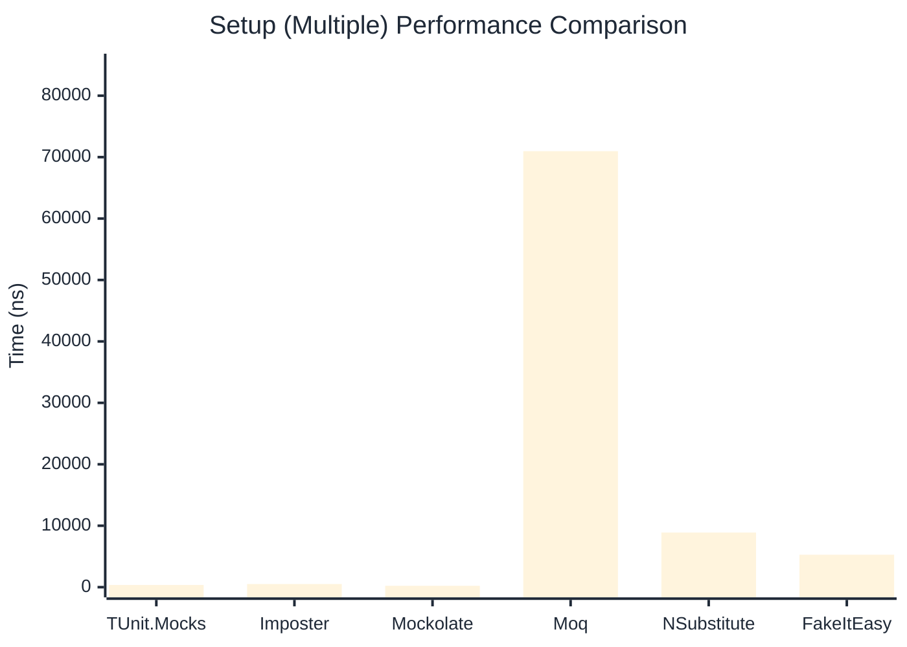

# Setup Benchmark

> Mock behavior configuration (returns, matchers) — comparing **TUnit.Mocks** (source-generated) against other source-generated and runtime proxy-based mocking libraries.

:::info Last Updated
This benchmark was automatically generated on **2026-11-22** from the latest CI run.

**Environment:** Ubuntu Latest • .NET SDK 11.0.100
:::

## 📊 Results

Mock behavior configuration (returns, matchers):

| Library | Mean | Error | StdDev | Allocated |
|---------|------|-------|--------|-----------|
| **TUnit.Mocks** | 199.1 ns | 1.33 ns | 1.25 ns | 1264 B |
| Imposter | 250.1 ns | 1.00 ns | 0.83 ns | 1360 B |
| Mockolate | 127.1 ns | 0.33 ns | 0.27 ns | 608 B |
| Moq | 265,527.2 ns | 2,162.88 ns | 1,917.34 ns | 29400 B |
| NSubstitute | 4,520.5 ns | 43.08 ns | 40.30 ns | 9184 B |
| FakeItEasy | 5,420.1 ns | 67.72 ns | 63.34 ns | 10386 B |

---

### Multiple

| Library | Mean | Error | StdDev | Allocated |
|---------|------|-------|--------|-----------|
| **TUnit.Mocks** | 352.7 ns | 5.30 ns | 4.69 ns | 2032 B |
| Imposter | 508.2 ns | 8.62 ns | 8.06 ns | 2536 B |
| Mockolate | 223.5 ns | 4.40 ns | 5.24 ns | 1032 B |
| Moq | 70,968.7 ns | 299.65 ns | 265.63 ns | 16271 B |
| NSubstitute | 8,887.8 ns | 175.52 ns | 316.49 ns | 20652 B |
| FakeItEasy | 5,280.3 ns | 69.12 ns | 64.66 ns | 11637 B |

## 🎯 Key Insights

This benchmark compares **TUnit.Mocks** (source-generated) against other source-generated and runtime proxy-based mocking libraries for mock behavior configuration (returns, matchers).

---

:::note Methodology
View the [mock benchmarks overview](/docs/benchmarks/mocks) for methodology details and environment information.
:::

*Last generated: 2026-11-22T02:21:53.323Z*
