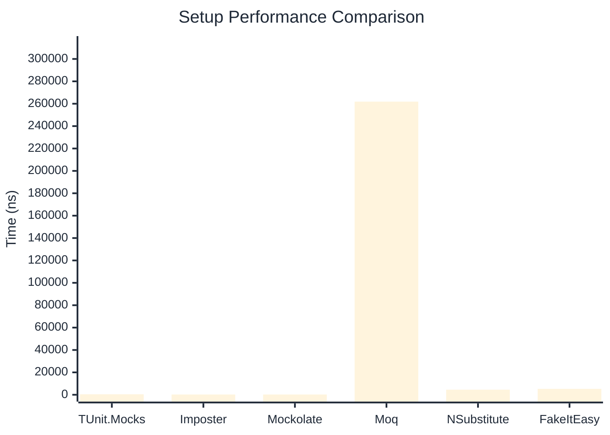

# Setup Benchmark

> Mock behavior configuration (returns, matchers) — comparing **TUnit.Mocks** (source-generated) against runtime proxy-based mocking libraries.

:::info Last Updated
This benchmark was automatically generated on **2026-11-19** from the latest CI run.

**Environment:** Ubuntu Latest • .NET SDK 11.0.100
:::

## 📊 Results

Mock behavior configuration (returns, matchers):

| Library | Mean | Error | StdDev | Allocated |
|---------|------|-------|--------|-----------|
| **TUnit.Mocks** | 424.1 ns | 3.48 ns | 3.09 ns | 2.38 KB |
| Imposter | 247.8 ns | 1.41 ns | 1.32 ns | 1.33 KB |
| Mockolate | 235.5 ns | 0.74 ns | 0.58 ns | 1.39 KB |
| Moq | 261,876.4 ns | 2,104.46 ns | 1,968.51 ns | 28.52 KB |
| NSubstitute | 4,543.7 ns | 74.62 ns | 66.14 ns | 9.02 KB |
| FakeItEasy | 5,273.7 ns | 79.04 ns | 70.07 ns | 10.14 KB |

---

### Multiple

| Library | Mean | Error | StdDev | Allocated |
|---------|------|-------|--------|-----------|
| **TUnit.Mocks** | 591.8 ns | 2.95 ns | 2.46 ns | 3.2 KB |
| Imposter | 447.7 ns | 2.38 ns | 1.99 ns | 2.48 KB |
| Mockolate | 402.3 ns | 6.36 ns | 5.95 ns | 2.31 KB |
| Moq | 67,713.7 ns | 348.97 ns | 326.43 ns | 15.89 KB |
| NSubstitute | 8,354.8 ns | 90.65 ns | 84.80 ns | 20.17 KB |
| FakeItEasy | 5,194.7 ns | 32.92 ns | 30.79 ns | 11.36 KB |

## 🎯 Key Insights

This benchmark compares **TUnit.Mocks** (source-generated) against runtime proxy-based mocking libraries for mock behavior configuration (returns, matchers).

---

:::note Methodology
View the [mock benchmarks overview](/docs/benchmarks/mocks) for methodology details and environment information.
:::

*Last generated: 2026-11-19T02:23:19.275Z*
