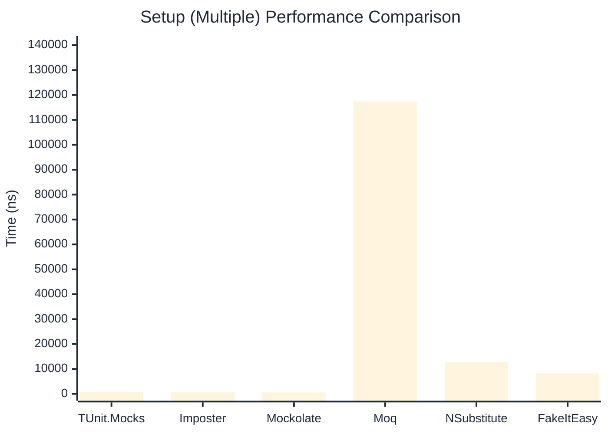

# Setup Benchmark

> Mock behavior configuration (returns, matchers) — comparing **TUnit.Mocks** (source-generated) against runtime proxy-based mocking libraries.

:::info Last Updated
This benchmark was automatically generated on **2026-11-08** from the latest CI run.

**Environment:** Ubuntu Latest • .NET SDK 10.0.403
:::

## 📊 Results

Mock behavior configuration (returns, matchers):

| Library | Mean | Error | StdDev | Allocated |
|---------|------|-------|--------|-----------|
| **TUnit.Mocks** | 570.2 ns | 8.81 ns | 8.24 ns | 2.38 KB |
| Imposter | 352.2 ns | 6.96 ns | 6.83 ns | 1.35 KB |
| Mockolate | 334.7 ns | 6.74 ns | 9.22 ns | 1.41 KB |
| Moq | 438,397.4 ns | 3,448.51 ns | 3,225.74 ns | 28.63 KB |
| NSubstitute | 6,340.8 ns | 93.07 ns | 82.50 ns | 9.01 KB |
| FakeItEasy | 8,440.8 ns | 141.68 ns | 132.52 ns | 10.45 KB |

---

### Multiple

| Library | Mean | Error | StdDev | Allocated |
|---------|------|-------|--------|-----------|
| **TUnit.Mocks** | 771.7 ns | 14.95 ns | 20.96 ns | 3.2 KB |
| Imposter | 581.1 ns | 11.68 ns | 21.94 ns | 2.52 KB |
| Mockolate | 551.7 ns | 10.83 ns | 13.31 ns | 2.35 KB |
| Moq | 117,422.1 ns | 332.25 ns | 277.45 ns | 16.46 KB |
| NSubstitute | 12,694.8 ns | 125.78 ns | 111.50 ns | 20.31 KB |
| FakeItEasy | 8,165.7 ns | 102.29 ns | 85.42 ns | 11.71 KB |

## 🎯 Key Insights

This benchmark compares **TUnit.Mocks** (source-generated) against runtime proxy-based mocking libraries for mock behavior configuration (returns, matchers).

---

:::note Methodology
View the [mock benchmarks overview](/docs/benchmarks/mocks) for methodology details and environment information.
:::

*Last generated: 2026-11-08T02:26:36.812Z*
