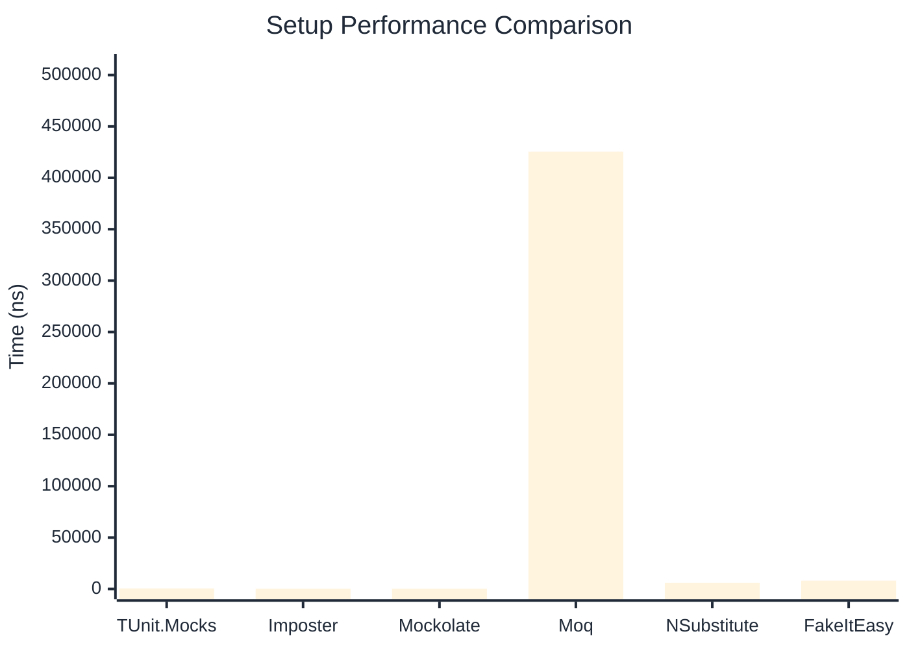

# Setup Benchmark

> Mock behavior configuration (returns, matchers) — comparing **TUnit.Mocks** (source-generated) against runtime proxy-based mocking libraries.

:::info Last Updated
This benchmark was automatically generated on **2026-11-06** from the latest CI run.

**Environment:** Ubuntu Latest • .NET SDK 10.0.403
:::

## 📊 Results

Mock behavior configuration (returns, matchers):

| Library | Mean | Error | StdDev | Allocated |
|---------|------|-------|--------|-----------|
| **TUnit.Mocks** | 533.3 ns | 2.77 ns | 2.59 ns | 2.38 KB |
| Imposter | 315.1 ns | 0.57 ns | 0.50 ns | 1.35 KB |
| Mockolate | 298.0 ns | 2.54 ns | 2.25 ns | 1.41 KB |
| Moq | 425,483.6 ns | 1,510.23 ns | 1,412.67 ns | 28.52 KB |
| NSubstitute | 6,054.4 ns | 17.11 ns | 14.28 ns | 9.01 KB |
| FakeItEasy | 8,110.0 ns | 45.99 ns | 40.77 ns | 10.45 KB |

---

### Multiple

| Library | Mean | Error | StdDev | Allocated |
|---------|------|-------|--------|-----------|
| **TUnit.Mocks** | 758.8 ns | 5.42 ns | 4.53 ns | 3.2 KB |
| Imposter | 573.1 ns | 4.19 ns | 3.50 ns | 2.52 KB |
| Mockolate | 527.9 ns | 10.09 ns | 8.94 ns | 2.35 KB |
| Moq | 113,693.8 ns | 426.55 ns | 378.13 ns | 16.46 KB |
| NSubstitute | 12,671.7 ns | 70.82 ns | 66.24 ns | 20.31 KB |
| FakeItEasy | 7,818.0 ns | 55.19 ns | 48.93 ns | 11.71 KB |

## 🎯 Key Insights

This benchmark compares **TUnit.Mocks** (source-generated) against runtime proxy-based mocking libraries for mock behavior configuration (returns, matchers).

---

:::note Methodology
View the [mock benchmarks overview](/docs/benchmarks/mocks) for methodology details and environment information.
:::

*Last generated: 2026-11-06T02:27:23.366Z*
