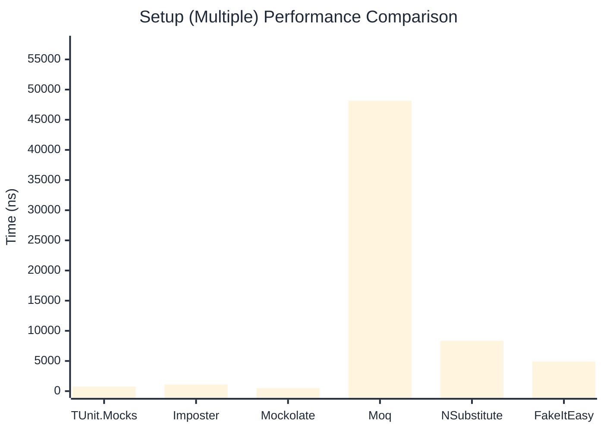

# Setup Benchmark

> Mock behavior configuration (returns, matchers) — comparing **TUnit.Mocks** (source-generated) against runtime proxy-based mocking libraries.

:::info Last Updated
This benchmark was automatically generated on **2026-10-11** from the latest CI run.

**Environment:** Ubuntu Latest • .NET SDK 10.0.401
:::

## 📊 Results

Mock behavior configuration (returns, matchers):

| Library | Mean | Error | StdDev | Allocated |
|---------|------|-------|--------|-----------|
| **TUnit.Mocks** | 517.4 ns | 10.16 ns | 12.84 ns | 2.37 KB |
| Imposter | 650.8 ns | 12.28 ns | 11.49 ns | 6.09 KB |
| Mockolate | 299.3 ns | 5.98 ns | 9.31 ns | 1.41 KB |
| Moq | 179,812.4 ns | 1,349.14 ns | 1,126.59 ns | 28.56 KB |
| NSubstitute | 5,451.6 ns | 89.69 ns | 83.89 ns | 9.01 KB |
| FakeItEasy | 5,240.3 ns | 103.38 ns | 110.62 ns | 10.44 KB |

---

### Multiple

| Library | Mean | Error | StdDev | Allocated |
|---------|------|-------|--------|-----------|
| **TUnit.Mocks** | 748.6 ns | 15.01 ns | 15.42 ns | 3.18 KB |
| Imposter | 1,118.1 ns | 11.25 ns | 10.52 ns | 10.55 KB |
| Mockolate | 480.4 ns | 3.08 ns | 2.73 ns | 2.35 KB |
| Moq | 48,156.9 ns | 174.85 ns | 146.01 ns | 16.33 KB |
| NSubstitute | 8,345.8 ns | 129.57 ns | 172.97 ns | 20.49 KB |
| FakeItEasy | 4,902.7 ns | 94.32 ns | 100.92 ns | 11.78 KB |

## 🎯 Key Insights

This benchmark compares **TUnit.Mocks** (source-generated) against runtime proxy-based mocking libraries for mock behavior configuration (returns, matchers).

---

:::note Methodology
View the [mock benchmarks overview](/docs/benchmarks/mocks) for methodology details and environment information.
:::

*Last generated: 2026-10-11T02:43:35.245Z*
