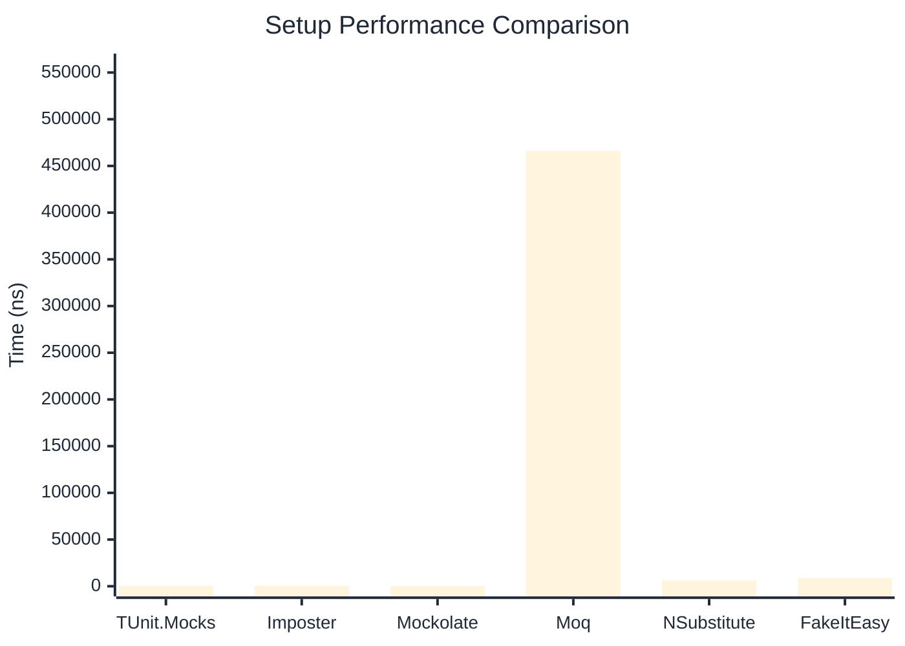
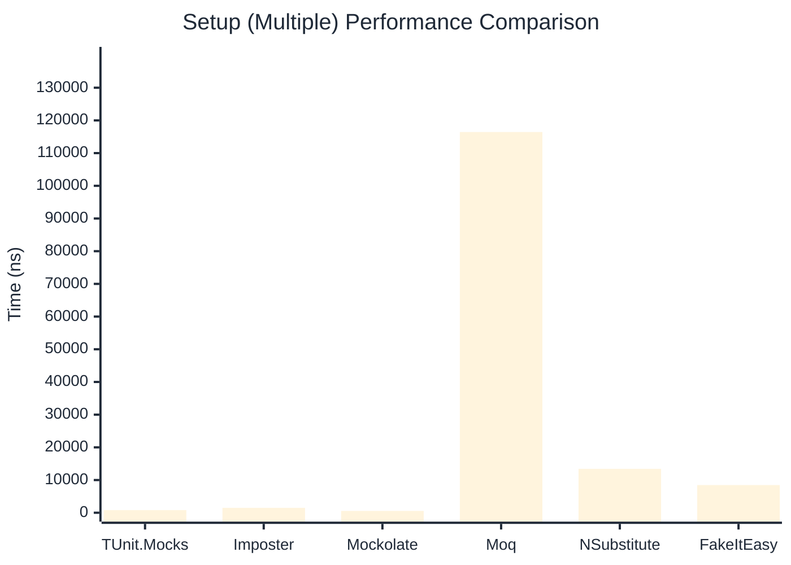

# Setup Benchmark

> Mock behavior configuration (returns, matchers) — comparing **TUnit.Mocks** (source-generated) against runtime proxy-based mocking libraries.

:::info Last Updated
This benchmark was automatically generated on **2026-10-25** from the latest CI run.

**Environment:** Ubuntu Latest • .NET SDK 10.0.402
:::

## 📊 Results

Mock behavior configuration (returns, matchers):

| Library | Mean | Error | StdDev | Allocated |
|---------|------|-------|--------|-----------|
| **TUnit.Mocks** | 556.6 ns | 5.70 ns | 5.33 ns | 2.38 KB |
| Imposter | 770.9 ns | 14.39 ns | 12.75 ns | 5.99 KB |
| Mockolate | 316.5 ns | 6.29 ns | 7.49 ns | 1.41 KB |
| Moq | 466,069.3 ns | 3,616.13 ns | 3,382.53 ns | 28.78 KB |
| NSubstitute | 6,256.7 ns | 43.63 ns | 38.68 ns | 9.01 KB |
| FakeItEasy | 8,731.4 ns | 156.27 ns | 146.18 ns | 10.45 KB |

---

### Multiple

| Library | Mean | Error | StdDev | Allocated |
|---------|------|-------|--------|-----------|
| **TUnit.Mocks** | 805.4 ns | 16.13 ns | 15.84 ns | 3.2 KB |
| Imposter | 1,493.6 ns | 29.95 ns | 40.99 ns | 10.3 KB |
| Mockolate | 550.1 ns | 10.95 ns | 16.39 ns | 2.35 KB |
| Moq | 116,454.0 ns | 1,155.51 ns | 1,080.86 ns | 16.35 KB |
| NSubstitute | 13,423.5 ns | 135.21 ns | 119.86 ns | 20.66 KB |
| FakeItEasy | 8,465.4 ns | 163.15 ns | 187.89 ns | 11.82 KB |

## 🎯 Key Insights

This benchmark compares **TUnit.Mocks** (source-generated) against runtime proxy-based mocking libraries for mock behavior configuration (returns, matchers).

---

:::note Methodology
View the [mock benchmarks overview](/docs/benchmarks/mocks) for methodology details and environment information.
:::

*Last generated: 2026-10-25T02:33:24.276Z*
