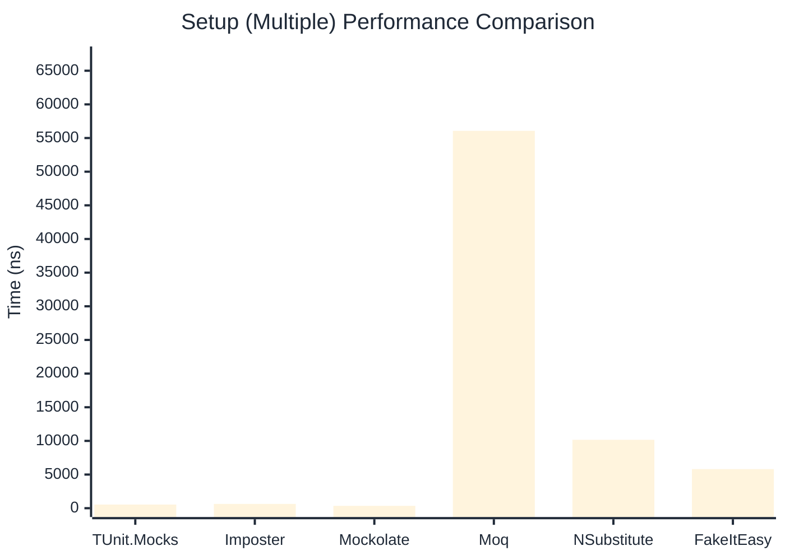

# Setup Benchmark

> Mock behavior configuration (returns, matchers) — comparing **TUnit.Mocks** (source-generated) against other source-generated and runtime proxy-based mocking libraries.

:::info Last Updated
This benchmark was automatically generated on **2026-11-23** from the latest CI run.

**Environment:** Ubuntu Latest • .NET SDK 11.0.100
:::

## 📊 Results

Mock behavior configuration (returns, matchers):

| Library | Mean | Error | StdDev | Allocated |
|---------|------|-------|--------|-----------|
| **TUnit.Mocks** | 328.5 ns | 3.56 ns | 3.33 ns | 1264 B |
| Imposter | 373.2 ns | 2.87 ns | 2.54 ns | 1360 B |
| Mockolate | 204.9 ns | 1.61 ns | 1.43 ns | 608 B |
| Moq | 224,229.7 ns | 3,708.65 ns | 3,469.07 ns | 29301 B |
| NSubstitute | 6,120.5 ns | 27.15 ns | 24.07 ns | 9184 B |
| FakeItEasy | 5,883.7 ns | 50.26 ns | 44.56 ns | 10381 B |

---

### Multiple

| Library | Mean | Error | StdDev | Allocated |
|---------|------|-------|--------|-----------|
| **TUnit.Mocks** | 541.9 ns | 9.56 ns | 8.94 ns | 2032 B |
| Imposter | 637.4 ns | 5.50 ns | 5.14 ns | 2536 B |
| Mockolate | 349.5 ns | 4.64 ns | 4.12 ns | 1032 B |
| Moq | 56,068.7 ns | 481.13 ns | 450.05 ns | 16383 B |
| NSubstitute | 10,160.5 ns | 60.47 ns | 53.60 ns | 20649 B |
| FakeItEasy | 5,810.8 ns | 36.06 ns | 33.73 ns | 11632 B |

## 🎯 Key Insights

This benchmark compares **TUnit.Mocks** (source-generated) against other source-generated and runtime proxy-based mocking libraries for mock behavior configuration (returns, matchers).

---

:::note Methodology
View the [mock benchmarks overview](/docs/benchmarks/mocks) for methodology details and environment information.
:::

*Last generated: 2026-11-23T02:22:45.286Z*
