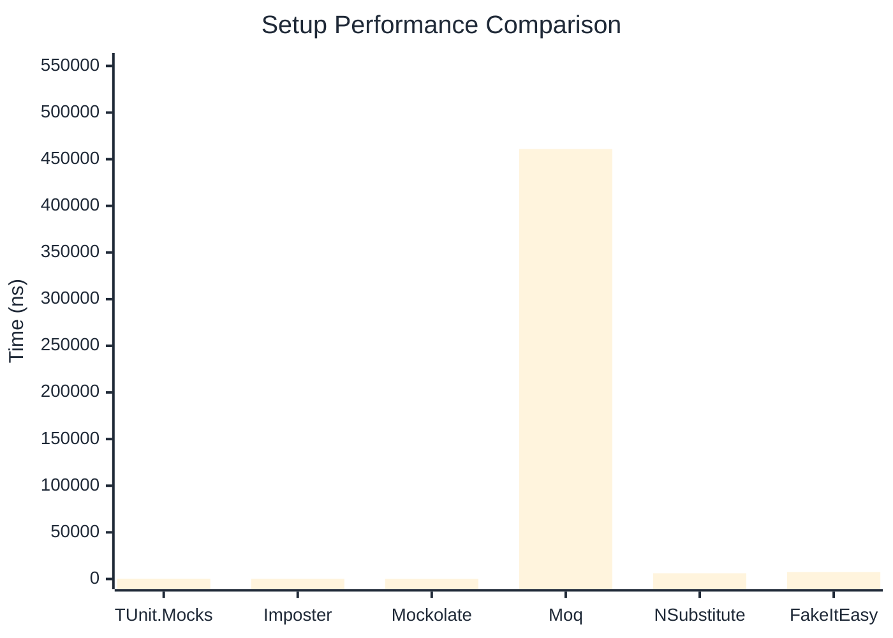

# Setup Benchmark

> Mock behavior configuration (returns, matchers) — comparing **TUnit.Mocks** (source-generated) against other source-generated and runtime proxy-based mocking libraries.

:::info Last Updated
This benchmark was automatically generated on **2026-11-20** from the latest CI run.

**Environment:** Ubuntu Latest • .NET SDK 11.0.100
:::

## 📊 Results

Mock behavior configuration (returns, matchers):

| Library | Mean | Error | StdDev | Allocated |
|---------|------|-------|--------|-----------|
| **TUnit.Mocks** | 319.9 ns | 4.41 ns | 4.12 ns | 1648 B |
| Imposter | 285.4 ns | 2.71 ns | 2.54 ns | 1360 B |
| Mockolate | 151.8 ns | 0.78 ns | 0.61 ns | 608 B |
| Moq | 460,897.2 ns | 1,590.43 ns | 1,487.69 ns | 29209 B |
| NSubstitute | 6,158.0 ns | 90.90 ns | 85.02 ns | 9240 B |
| FakeItEasy | 7,405.1 ns | 82.22 ns | 76.91 ns | 10386 B |

---

### Multiple

| Library | Mean | Error | StdDev | Allocated |
|---------|------|-------|--------|-----------|
| **TUnit.Mocks** | 474.2 ns | 2.67 ns | 2.23 ns | 2272 B |
| Imposter | 536.3 ns | 4.24 ns | 3.76 ns | 2536 B |
| Mockolate | 273.0 ns | 4.46 ns | 4.17 ns | 1032 B |
| Moq | 112,447.5 ns | 497.46 ns | 465.32 ns | 16271 B |
| NSubstitute | 12,138.3 ns | 86.41 ns | 76.60 ns | 20818 B |
| FakeItEasy | 7,073.2 ns | 41.15 ns | 38.49 ns | 11637 B |

## 🎯 Key Insights

This benchmark compares **TUnit.Mocks** (source-generated) against other source-generated and runtime proxy-based mocking libraries for mock behavior configuration (returns, matchers).

---

:::note Methodology
View the [mock benchmarks overview](/docs/benchmarks/mocks) for methodology details and environment information.
:::

*Last generated: 2026-11-20T02:20:51.427Z*
