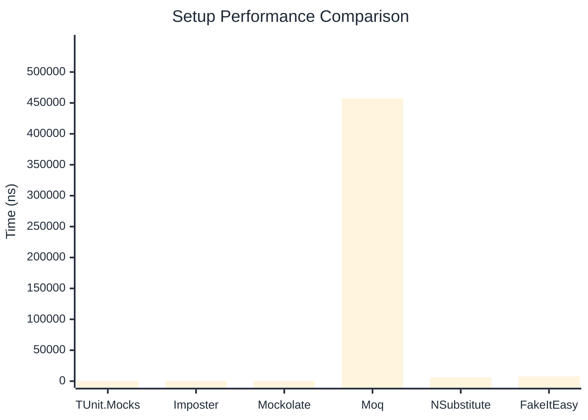
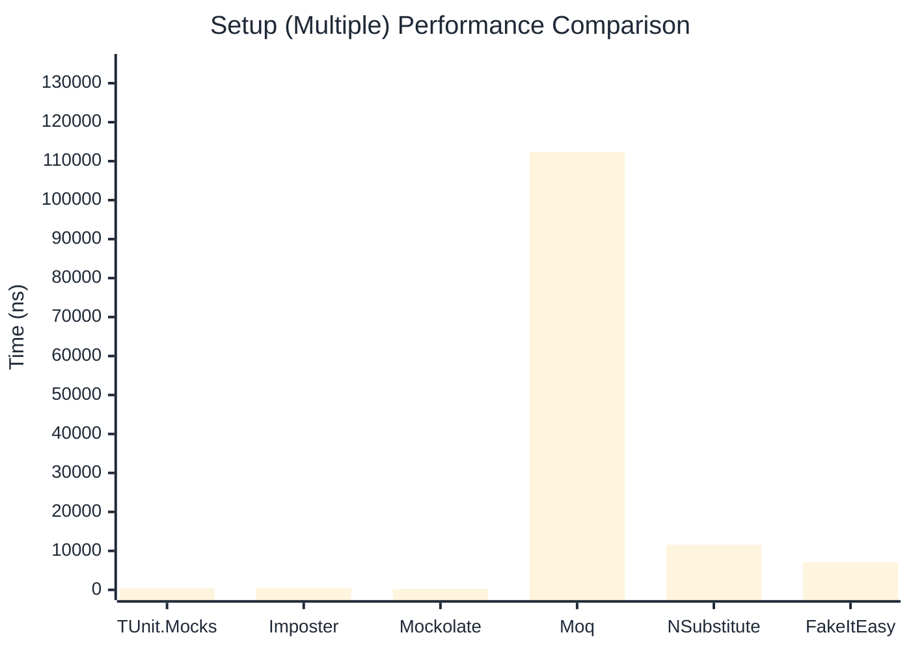

# Setup Benchmark

> Mock behavior configuration (returns, matchers) — comparing **TUnit.Mocks** (source-generated) against other source-generated and runtime proxy-based mocking libraries.

:::info Last Updated
This benchmark was automatically generated on **2026-11-24** from the latest CI run.

**Environment:** Ubuntu Latest • .NET SDK 11.0.100
:::

## 📊 Results

Mock behavior configuration (returns, matchers):

| Library | Mean | Error | StdDev | Allocated |
|---------|------|-------|--------|-----------|
| **TUnit.Mocks** | 236.8 ns | 2.85 ns | 2.52 ns | 1264 B |
| Imposter | 294.9 ns | 3.68 ns | 3.07 ns | 1360 B |
| Mockolate | 151.2 ns | 1.03 ns | 0.96 ns | 608 B |
| Moq | 457,787.3 ns | 1,809.18 ns | 1,692.31 ns | 29432 B |
| NSubstitute | 6,029.6 ns | 40.27 ns | 35.70 ns | 9184 B |
| FakeItEasy | 7,616.1 ns | 64.66 ns | 60.48 ns | 10466 B |

---

### Multiple

| Library | Mean | Error | StdDev | Allocated |
|---------|------|-------|--------|-----------|
| **TUnit.Mocks** | 407.8 ns | 3.06 ns | 2.71 ns | 2032 B |
| Imposter | 521.8 ns | 5.01 ns | 4.69 ns | 2536 B |
| Mockolate | 273.4 ns | 3.55 ns | 3.32 ns | 1032 B |
| Moq | 112,381.7 ns | 342.33 ns | 320.22 ns | 16271 B |
| NSubstitute | 11,555.9 ns | 65.91 ns | 61.65 ns | 20652 B |
| FakeItEasy | 7,084.7 ns | 50.62 ns | 47.35 ns | 11637 B |

## 🎯 Key Insights

This benchmark compares **TUnit.Mocks** (source-generated) against other source-generated and runtime proxy-based mocking libraries for mock behavior configuration (returns, matchers).

---

:::note Methodology
View the [mock benchmarks overview](/docs/benchmarks/mocks) for methodology details and environment information.
:::

*Last generated: 2026-11-24T02:20:52.556Z*
