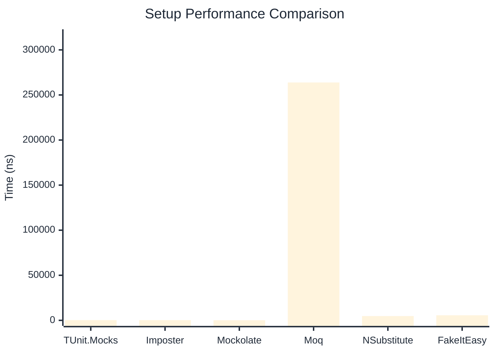
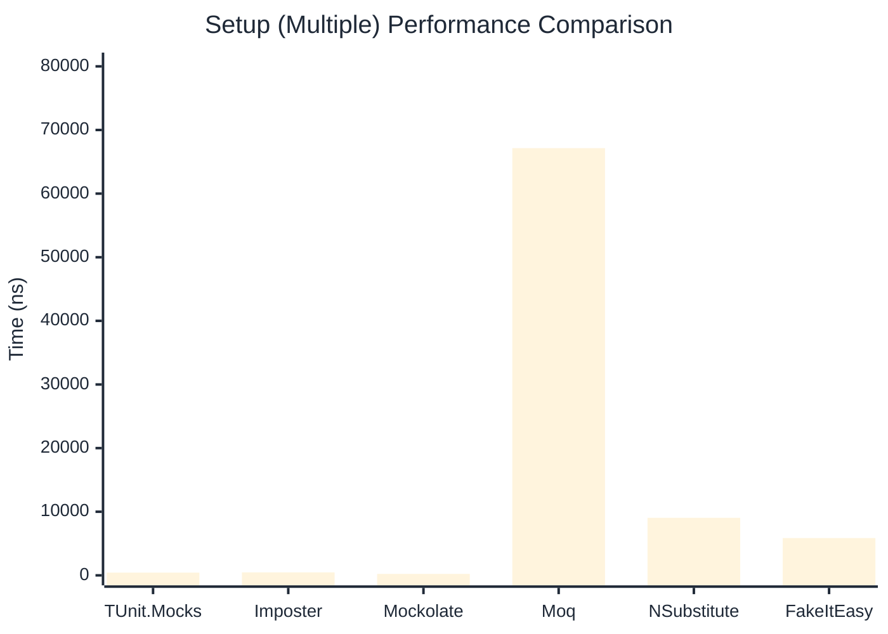

# Setup Benchmark

> Mock behavior configuration (returns, matchers) — comparing **TUnit.Mocks** (source-generated) against other source-generated and runtime proxy-based mocking libraries.

:::info Last Updated
This benchmark was automatically generated on **2026-11-21** from the latest CI run.

**Environment:** Ubuntu Latest • .NET SDK 11.0.100
:::

## 📊 Results

Mock behavior configuration (returns, matchers):

| Library | Mean | Error | StdDev | Allocated |
|---------|------|-------|--------|-----------|
| **TUnit.Mocks** | 289.1 ns | 4.89 ns | 4.33 ns | 1648 B |
| Imposter | 268.2 ns | 4.18 ns | 3.70 ns | 1360 B |
| Mockolate | 133.7 ns | 1.80 ns | 1.50 ns | 608 B |
| Moq | 263,856.3 ns | 3,077.96 ns | 2,728.53 ns | 29448 B |
| NSubstitute | 4,765.0 ns | 49.55 ns | 46.35 ns | 9184 B |
| FakeItEasy | 5,606.5 ns | 63.95 ns | 56.69 ns | 10386 B |

---

### Multiple

| Library | Mean | Error | StdDev | Allocated |
|---------|------|-------|--------|-----------|
| **TUnit.Mocks** | 431.2 ns | 8.21 ns | 7.68 ns | 2272 B |
| Imposter | 472.0 ns | 4.25 ns | 3.97 ns | 2536 B |
| Mockolate | 223.7 ns | 1.72 ns | 1.61 ns | 1032 B |
| Moq | 67,148.8 ns | 585.49 ns | 547.67 ns | 16271 B |
| NSubstitute | 9,045.7 ns | 81.33 ns | 67.91 ns | 20818 B |
| FakeItEasy | 5,863.4 ns | 96.25 ns | 90.03 ns | 11717 B |

## 🎯 Key Insights

This benchmark compares **TUnit.Mocks** (source-generated) against other source-generated and runtime proxy-based mocking libraries for mock behavior configuration (returns, matchers).

---

:::note Methodology
View the [mock benchmarks overview](/docs/benchmarks/mocks) for methodology details and environment information.
:::

*Last generated: 2026-11-21T02:20:26.016Z*
