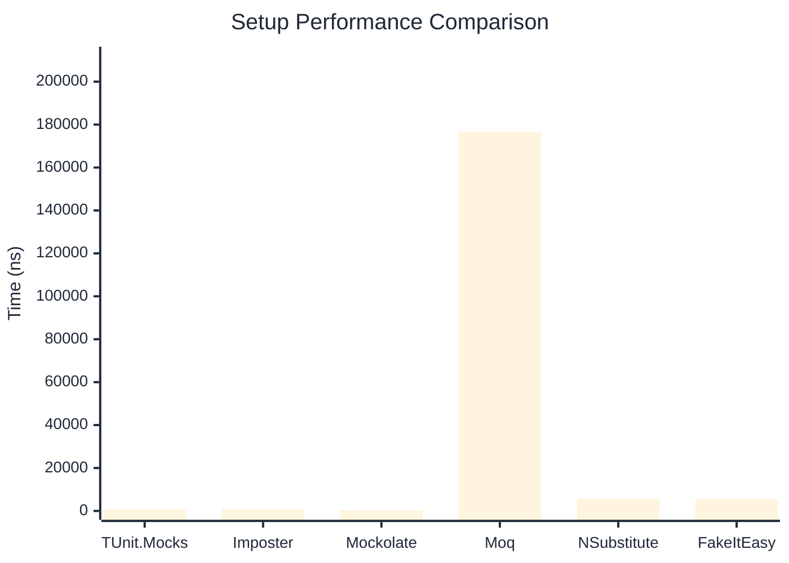
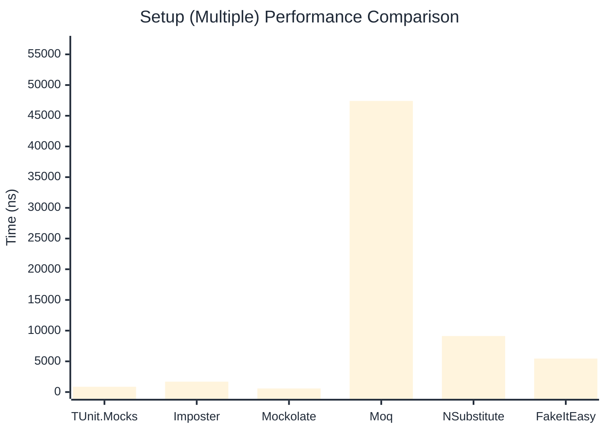

# Setup Benchmark

> Mock behavior configuration (returns, matchers) — comparing **TUnit.Mocks** (source-generated) against runtime proxy-based mocking libraries.

:::info Last Updated
This benchmark was automatically generated on **2026-10-16** from the latest CI run.

**Environment:** Ubuntu Latest • .NET SDK 10.0.402
:::

## 📊 Results

Mock behavior configuration (returns, matchers):

| Library | Mean | Error | StdDev | Allocated |
|---------|------|-------|--------|-----------|
| **TUnit.Mocks** | 585.9 ns | 7.44 ns | 6.22 ns | 2.38 KB |
| Imposter | 922.9 ns | 18.50 ns | 42.88 ns | 5.99 KB |
| Mockolate | 337.1 ns | 6.81 ns | 6.99 ns | 1.41 KB |
| Moq | 176,768.6 ns | 3,329.86 ns | 2,780.58 ns | 28.56 KB |
| NSubstitute | 5,502.0 ns | 108.81 ns | 133.63 ns | 9.01 KB |
| FakeItEasy | 5,529.3 ns | 71.92 ns | 63.76 ns | 10.44 KB |

---

### Multiple

| Library | Mean | Error | StdDev | Allocated |
|---------|------|-------|--------|-----------|
| **TUnit.Mocks** | 857.2 ns | 8.95 ns | 7.48 ns | 3.2 KB |
| Imposter | 1,690.5 ns | 33.75 ns | 74.08 ns | 10.53 KB |
| Mockolate | 580.7 ns | 8.15 ns | 7.62 ns | 2.35 KB |
| Moq | 47,412.7 ns | 924.03 ns | 907.52 ns | 16.33 KB |
| NSubstitute | 9,127.2 ns | 175.63 ns | 209.08 ns | 20.49 KB |
| FakeItEasy | 5,449.2 ns | 85.34 ns | 79.83 ns | 11.81 KB |

## 🎯 Key Insights

This benchmark compares **TUnit.Mocks** (source-generated) against runtime proxy-based mocking libraries for mock behavior configuration (returns, matchers).

---

:::note Methodology
View the [mock benchmarks overview](/docs/benchmarks/mocks) for methodology details and environment information.
:::

*Last generated: 2026-10-16T03:11:30.127Z*
