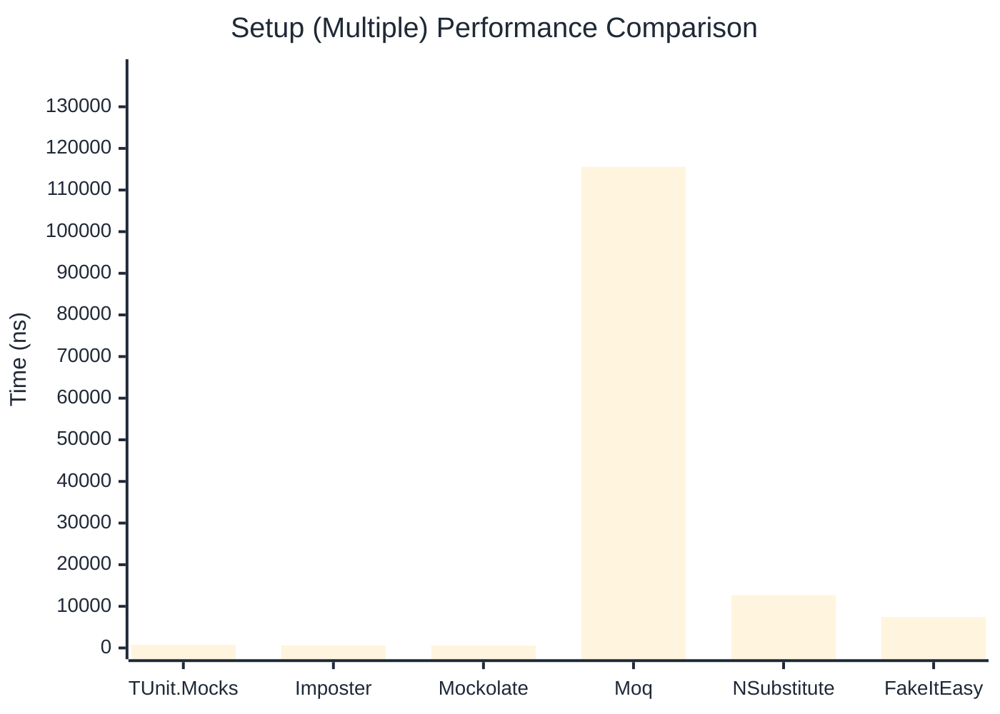

# Setup Benchmark

> Mock behavior configuration (returns, matchers) — comparing **TUnit.Mocks** (source-generated) against runtime proxy-based mocking libraries.

:::info Last Updated
This benchmark was automatically generated on **2026-11-14** from the latest CI run.

**Environment:** Ubuntu Latest • .NET SDK 11.0.100
:::

## 📊 Results

Mock behavior configuration (returns, matchers):

| Library | Mean | Error | StdDev | Allocated |
|---------|------|-------|--------|-----------|
| **TUnit.Mocks** | 508.3 ns | 10.03 ns | 9.38 ns | 2.38 KB |
| Imposter | 309.0 ns | 4.41 ns | 4.13 ns | 1.33 KB |
| Mockolate | 293.4 ns | 4.13 ns | 3.86 ns | 1.39 KB |
| Moq | 466,898.2 ns | 1,423.67 ns | 1,188.83 ns | 28.52 KB |
| NSubstitute | 6,248.1 ns | 29.12 ns | 27.24 ns | 8.97 KB |
| FakeItEasy | 7,679.1 ns | 48.67 ns | 45.52 ns | 10.14 KB |

---

### Multiple

| Library | Mean | Error | StdDev | Allocated |
|---------|------|-------|--------|-----------|
| **TUnit.Mocks** | 785.6 ns | 14.13 ns | 13.22 ns | 3.2 KB |
| Imposter | 585.4 ns | 11.58 ns | 17.33 ns | 2.48 KB |
| Mockolate | 541.3 ns | 10.16 ns | 9.50 ns | 2.31 KB |
| Moq | 115,577.1 ns | 535.08 ns | 474.33 ns | 15.89 KB |
| NSubstitute | 12,664.7 ns | 56.05 ns | 43.76 ns | 20.33 KB |
| FakeItEasy | 7,444.0 ns | 54.60 ns | 51.07 ns | 11.36 KB |

## 🎯 Key Insights

This benchmark compares **TUnit.Mocks** (source-generated) against runtime proxy-based mocking libraries for mock behavior configuration (returns, matchers).

---

:::note Methodology
View the [mock benchmarks overview](/docs/benchmarks/mocks) for methodology details and environment information.
:::

*Last generated: 2026-11-14T02:21:36.343Z*
