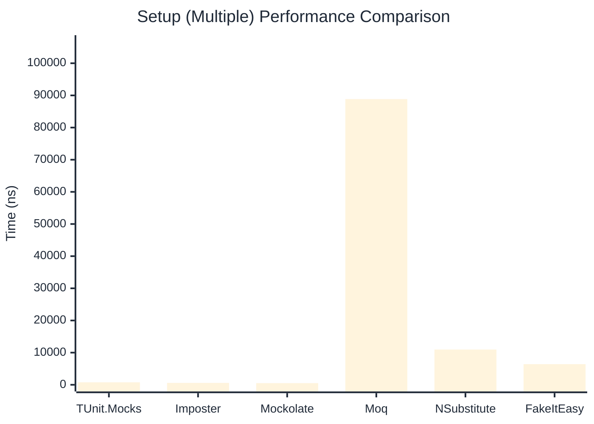

# Setup Benchmark

> Mock behavior configuration (returns, matchers) — comparing **TUnit.Mocks** (source-generated) against runtime proxy-based mocking libraries.

:::info Last Updated
This benchmark was automatically generated on **2026-11-12** from the latest CI run.

**Environment:** Ubuntu Latest • .NET SDK 11.0.100
:::

## 📊 Results

Mock behavior configuration (returns, matchers):

| Library | Mean | Error | StdDev | Allocated |
|---------|------|-------|--------|-----------|
| **TUnit.Mocks** | 525.8 ns | 6.86 ns | 6.42 ns | 2.38 KB |
| Imposter | 331.6 ns | 6.03 ns | 5.35 ns | 1.33 KB |
| Mockolate | 311.1 ns | 2.35 ns | 2.09 ns | 1.39 KB |
| Moq | 345,701.0 ns | 3,411.09 ns | 3,190.73 ns | 28.67 KB |
| NSubstitute | 5,793.4 ns | 110.02 ns | 102.91 ns | 8.97 KB |
| FakeItEasy | 6,798.7 ns | 62.36 ns | 52.07 ns | 10.14 KB |

---

### Multiple

| Library | Mean | Error | StdDev | Allocated |
|---------|------|-------|--------|-----------|
| **TUnit.Mocks** | 769.7 ns | 6.12 ns | 5.73 ns | 3.2 KB |
| Imposter | 581.5 ns | 3.93 ns | 3.48 ns | 2.48 KB |
| Mockolate | 517.0 ns | 10.18 ns | 9.53 ns | 2.31 KB |
| Moq | 88,862.7 ns | 419.67 ns | 350.44 ns | 16 KB |
| NSubstitute | 10,962.1 ns | 203.04 ns | 179.99 ns | 20.5 KB |
| FakeItEasy | 6,414.6 ns | 76.29 ns | 71.36 ns | 11.36 KB |

## 🎯 Key Insights

This benchmark compares **TUnit.Mocks** (source-generated) against runtime proxy-based mocking libraries for mock behavior configuration (returns, matchers).

---

:::note Methodology
View the [mock benchmarks overview](/docs/benchmarks/mocks) for methodology details and environment information.
:::

*Last generated: 2026-11-12T02:21:42.541Z*
