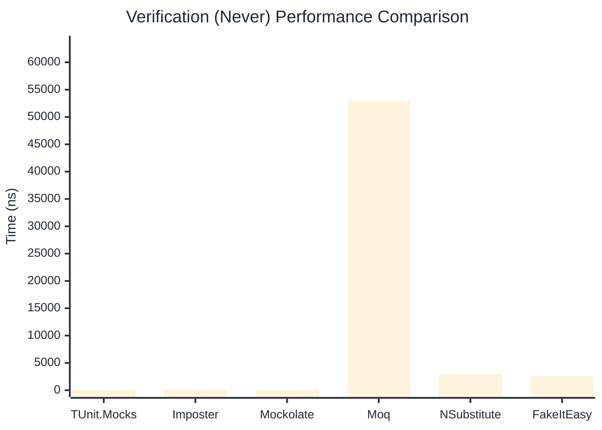

# Verification Benchmark

> Mock verification workflows, including creation, setup and invocation where applicable — comparing **TUnit.Mocks** (source-generated) against other source-generated and runtime proxy-based mocking libraries.

:::info Last Updated
This benchmark was automatically generated on **2026-11-20** from the latest CI run.

**Environment:** Ubuntu Latest • .NET SDK 11.0.100
:::

## 📊 Results

Mock verification workflows, including creation, setup and invocation where applicable:

| Library | Mean | Error | StdDev | Allocated |
|---------|------|-------|--------|-----------|
| **TUnit.Mocks** | 434.57 ns | 8.388 ns | 7.846 ns | 1800 B |
| Imposter | 230.93 ns | 3.917 ns | 3.664 ns | 1096 B |
| Mockolate | 152.29 ns | 3.012 ns | 3.223 ns | 712 B |
| Moq | 207,119.90 ns | 1,816.540 ns | 1,516.893 ns | 24316 B |
| NSubstitute | 5,344.59 ns | 46.473 ns | 41.197 ns | 10024 B |
| FakeItEasy | 5,288.51 ns | 63.349 ns | 59.257 ns | 10506 B |

---

### Never

| Library | Mean | Error | StdDev | Allocated |
|---------|------|-------|--------|-----------|
| **TUnit.Mocks** | 44.80 ns | 0.717 ns | 0.635 ns | 352 B |
| Imposter | 115.49 ns | 1.532 ns | 1.433 ns | 616 B |
| Mockolate | 62.10 ns | 0.725 ns | 0.678 ns | 368 B |
| Moq | 53,023.79 ns | 475.581 ns | 444.859 ns | 6917 B |
| NSubstitute | 2,930.59 ns | 11.398 ns | 9.518 ns | 7056 B |
| FakeItEasy | 2,636.32 ns | 27.647 ns | 24.509 ns | 5105 B |

---

### Multiple

| Library | Mean | Error | StdDev | Allocated |
|---------|------|-------|--------|-----------|
| **TUnit.Mocks** | 798.81 ns | 7.569 ns | 6.709 ns | 3240 B |
| Imposter | 465.93 ns | 5.486 ns | 4.864 ns | 2288 B |
| Mockolate | 330.54 ns | 4.866 ns | 4.314 ns | 1360 B |
| Moq | 298,487.89 ns | 1,347.291 ns | 1,260.257 ns | 34890 B |
| NSubstitute | 9,162.94 ns | 67.987 ns | 60.269 ns | 16633 B |
| FakeItEasy | 9,339.10 ns | 73.401 ns | 65.068 ns | 18703 B |

## 🎯 Key Insights

This benchmark compares **TUnit.Mocks** (source-generated) against other source-generated and runtime proxy-based mocking libraries for mock verification workflows, including creation, setup and invocation where applicable.

---

:::note Methodology
View the [mock benchmarks overview](/docs/benchmarks/mocks) for methodology details and environment information.
:::

*Last generated: 2026-11-20T02:20:51.427Z*
