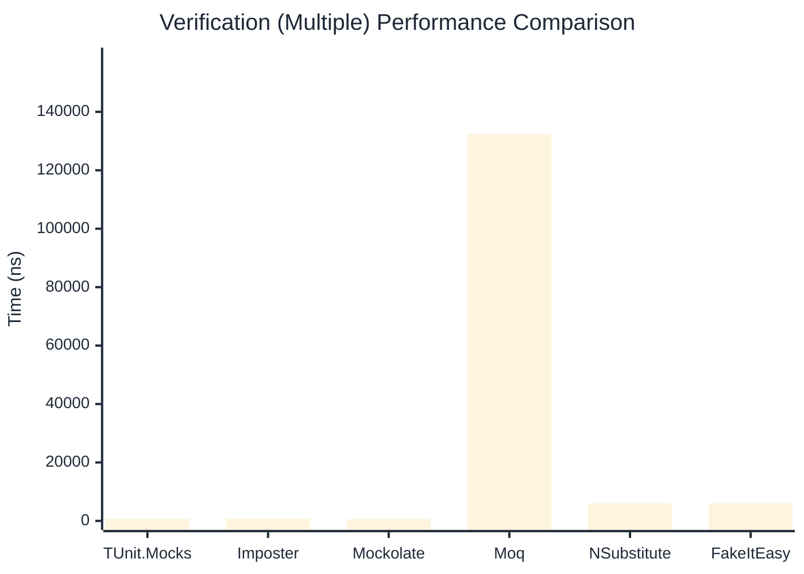

# Verification Benchmark

> Verifying mock method calls — comparing **TUnit.Mocks** (source-generated) against runtime proxy-based mocking libraries.

:::info Last Updated
This benchmark was automatically generated on **2026-10-16** from the latest CI run.

**Environment:** Ubuntu Latest • .NET SDK 10.0.402
:::

## 📊 Results

Verifying mock method calls:

| Library | Mean | Error | StdDev | Allocated |
|---------|------|-------|--------|-----------|
| **TUnit.Mocks** | 409.68 ns | 7.361 ns | 6.886 ns | 3040 B |
| Imposter | 330.85 ns | 3.977 ns | 3.321 ns | 4504 B |
| Mockolate | 231.52 ns | 2.330 ns | 1.946 ns | 2128 B |
| Moq | 101,001.39 ns | 1,201.897 ns | 1,065.450 ns | 24340 B |
| NSubstitute | 3,313.63 ns | 34.891 ns | 30.930 ns | 10176 B |
| FakeItEasy | 3,352.41 ns | 12.587 ns | 10.510 ns | 10722 B |

---

### Never

| Library | Mean | Error | StdDev | Allocated |
|---------|------|-------|--------|-----------|
| **TUnit.Mocks** | 31.06 ns | 0.228 ns | 0.202 ns | 336 B |
| Imposter | 168.36 ns | 2.902 ns | 2.714 ns | 2400 B |
| Mockolate | 130.41 ns | 1.085 ns | 0.906 ns | 1144 B |
| Moq | 24,997.15 ns | 242.045 ns | 214.567 ns | 6925 B |
| NSubstitute | 1,831.54 ns | 6.043 ns | 5.357 ns | 7088 B |
| FakeItEasy | 1,642.53 ns | 9.329 ns | 7.790 ns | 5210 B |

---

### Multiple

| Library | Mean | Error | StdDev | Allocated |
|---------|------|-------|--------|-----------|
| **TUnit.Mocks** | 707.71 ns | 10.582 ns | 9.899 ns | 4528 B |
| Imposter | 800.27 ns | 4.305 ns | 3.816 ns | 10840 B |
| Mockolate | 593.95 ns | 3.829 ns | 3.197 ns | 5240 B |
| Moq | 132,379.80 ns | 1,163.701 ns | 1,031.591 ns | 34810 B |
| NSubstitute | 6,026.27 ns | 44.750 ns | 39.670 ns | 16761 B |
| FakeItEasy | 6,032.00 ns | 29.746 ns | 24.839 ns | 19232 B |

## 🎯 Key Insights

This benchmark compares **TUnit.Mocks** (source-generated) against runtime proxy-based mocking libraries for verifying mock method calls.

---

:::note Methodology
View the [mock benchmarks overview](/docs/benchmarks/mocks) for methodology details and environment information.
:::

*Last generated: 2026-10-16T03:11:30.127Z*
