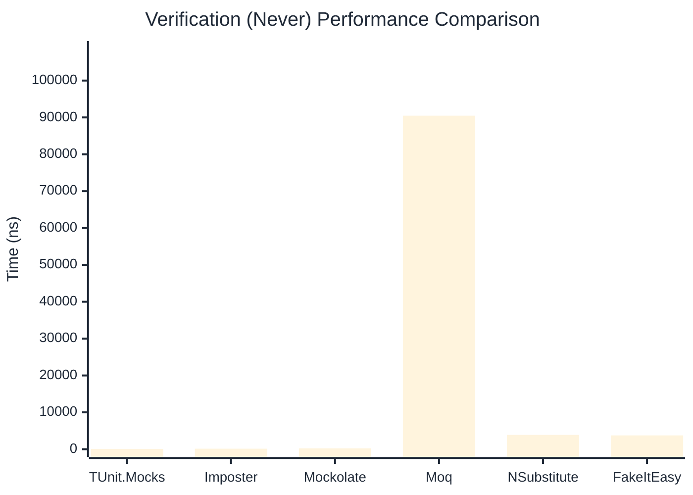
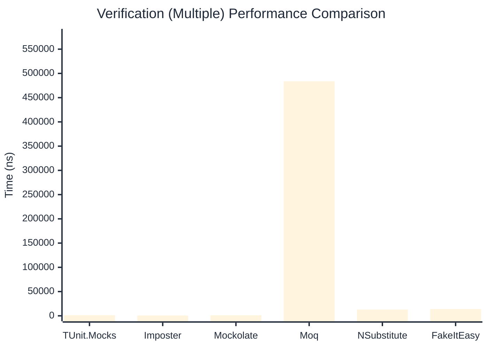

# Verification Benchmark

> Verifying mock method calls — comparing **TUnit.Mocks** (source-generated) against runtime proxy-based mocking libraries.

:::info Last Updated
This benchmark was automatically generated on **2026-11-10** from the latest CI run.

**Environment:** Ubuntu Latest • .NET SDK 10.0.403
:::

## 📊 Results

Verifying mock method calls:

| Library | Mean | Error | StdDev | Allocated |
|---------|------|-------|--------|-----------|
| **TUnit.Mocks** | 822.43 ns | 8.777 ns | 7.781 ns | 3040 B |
| Imposter | 306.92 ns | 5.550 ns | 5.192 ns | 1104 B |
| Mockolate | 451.10 ns | 9.070 ns | 8.040 ns | 2128 B |
| Moq | 344,768.81 ns | 3,088.389 ns | 2,737.776 ns | 24325 B |
| NSubstitute | 7,321.21 ns | 97.702 ns | 86.610 ns | 10064 B |
| FakeItEasy | 7,648.37 ns | 141.602 ns | 132.455 ns | 10722 B |

---

### Never

| Library | Mean | Error | StdDev | Allocated |
|---------|------|-------|--------|-----------|
| **TUnit.Mocks** | 59.81 ns | 1.176 ns | 1.308 ns | 336 B |
| Imposter | 142.20 ns | 2.860 ns | 3.512 ns | 616 B |
| Mockolate | 249.29 ns | 5.030 ns | 8.809 ns | 1144 B |
| Moq | 90,482.33 ns | 937.715 ns | 831.260 ns | 6918 B |
| NSubstitute | 3,880.30 ns | 16.410 ns | 15.350 ns | 7088 B |
| FakeItEasy | 3,747.48 ns | 49.054 ns | 45.885 ns | 5209 B |

---

### Multiple

| Library | Mean | Error | StdDev | Allocated |
|---------|------|-------|--------|-----------|
| **TUnit.Mocks** | 1,285.78 ns | 15.223 ns | 13.495 ns | 4528 B |
| Imposter | 583.38 ns | 11.525 ns | 10.781 ns | 2304 B |
| Mockolate | 1,114.88 ns | 21.433 ns | 21.050 ns | 5240 B |
| Moq | 483,713.32 ns | 4,485.979 ns | 4,196.188 ns | 34986 B |
| NSubstitute | 12,865.53 ns | 117.911 ns | 110.294 ns | 16889 B |
| FakeItEasy | 13,879.24 ns | 167.923 ns | 140.223 ns | 19233 B |

## 🎯 Key Insights

This benchmark compares **TUnit.Mocks** (source-generated) against runtime proxy-based mocking libraries for verifying mock method calls.

---

:::note Methodology
View the [mock benchmarks overview](/docs/benchmarks/mocks) for methodology details and environment information.
:::

*Last generated: 2026-11-10T02:26:34.876Z*
