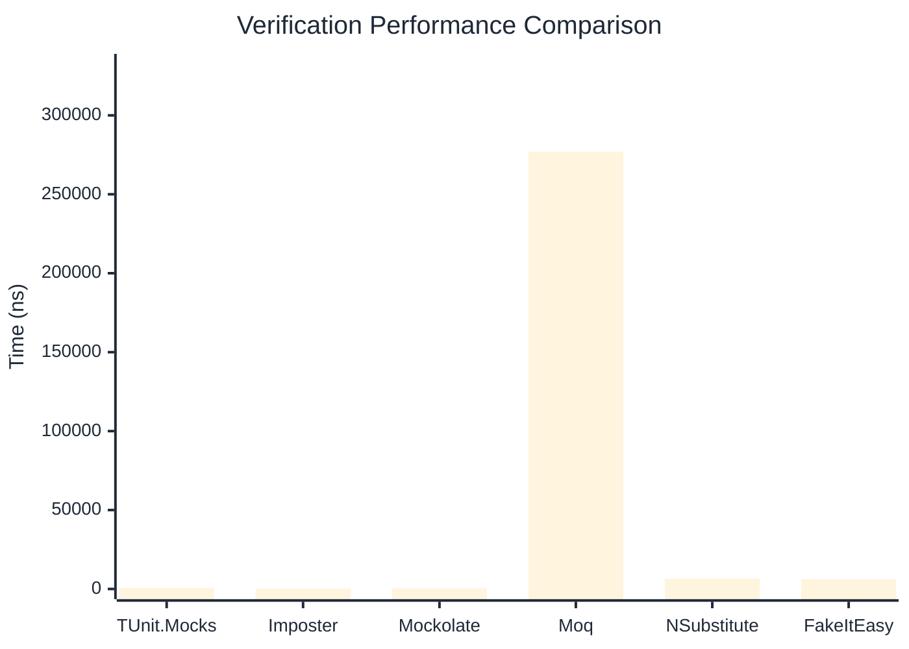
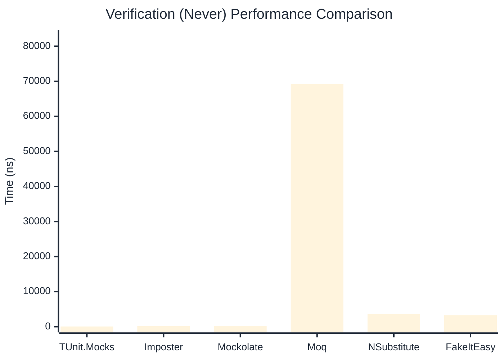

# Verification Benchmark

> Verifying mock method calls — comparing **TUnit.Mocks** (source-generated) against runtime proxy-based mocking libraries.

:::info Last Updated
This benchmark was automatically generated on **2026-11-12** from the latest CI run.

**Environment:** Ubuntu Latest • .NET SDK 11.0.100
:::

## 📊 Results

Verifying mock method calls:

| Library | Mean | Error | StdDev | Allocated |
|---------|------|-------|--------|-----------|
| **TUnit.Mocks** | 736.37 ns | 5.165 ns | 4.832 ns | 3040 B |
| Imposter | 277.96 ns | 3.553 ns | 3.324 ns | 1096 B |
| Mockolate | 389.24 ns | 2.691 ns | 2.247 ns | 2088 B |
| Moq | 277,018.99 ns | 1,633.598 ns | 1,528.069 ns | 24300 B |
| NSubstitute | 6,573.57 ns | 122.664 ns | 114.740 ns | 10024 B |
| FakeItEasy | 6,287.98 ns | 96.964 ns | 90.700 ns | 10506 B |

---

### Never

| Library | Mean | Error | StdDev | Allocated |
|---------|------|-------|--------|-----------|
| **TUnit.Mocks** | 59.92 ns | 1.136 ns | 1.062 ns | 336 B |
| Imposter | 149.09 ns | 2.276 ns | 2.129 ns | 616 B |
| Mockolate | 239.07 ns | 3.421 ns | 3.200 ns | 1096 B |
| Moq | 69,193.02 ns | 521.192 ns | 487.523 ns | 6917 B |
| NSubstitute | 3,573.91 ns | 63.607 ns | 56.386 ns | 7056 B |
| FakeItEasy | 3,258.26 ns | 38.522 ns | 36.034 ns | 5105 B |

---

### Multiple

| Library | Mean | Error | StdDev | Allocated |
|---------|------|-------|--------|-----------|
| **TUnit.Mocks** | 1,304.14 ns | 10.523 ns | 8.787 ns | 4528 B |
| Imposter | 583.07 ns | 6.706 ns | 6.273 ns | 2288 B |
| Mockolate | 1,016.51 ns | 7.047 ns | 6.247 ns | 5128 B |
| Moq | 385,311.39 ns | 1,923.941 ns | 1,705.523 ns | 35002 B |
| NSubstitute | 11,247.96 ns | 163.586 ns | 153.018 ns | 16633 B |
| FakeItEasy | 11,300.03 ns | 216.758 ns | 212.885 ns | 18703 B |

## 🎯 Key Insights

This benchmark compares **TUnit.Mocks** (source-generated) against runtime proxy-based mocking libraries for verifying mock method calls.

---

:::note Methodology
View the [mock benchmarks overview](/docs/benchmarks/mocks) for methodology details and environment information.
:::

*Last generated: 2026-11-12T02:21:42.541Z*
