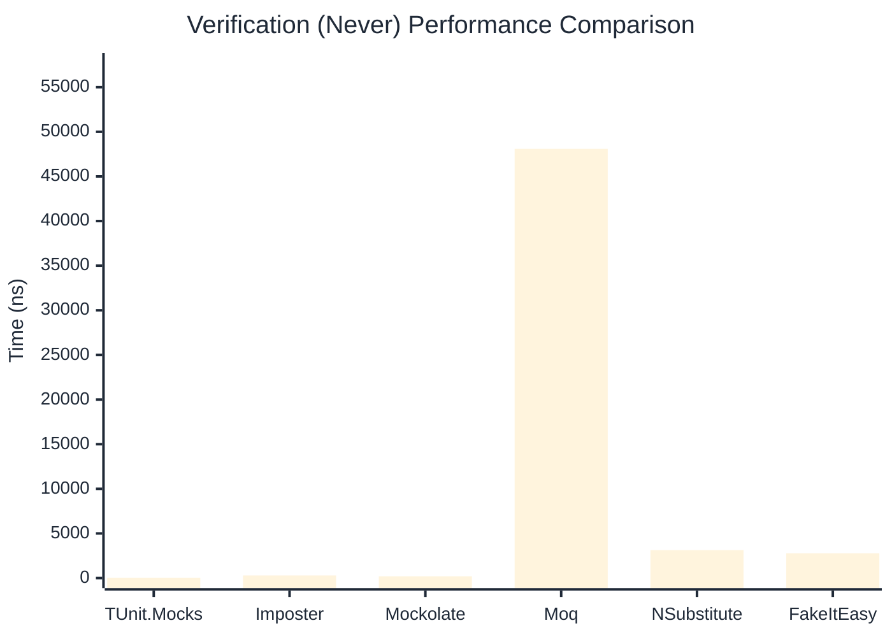
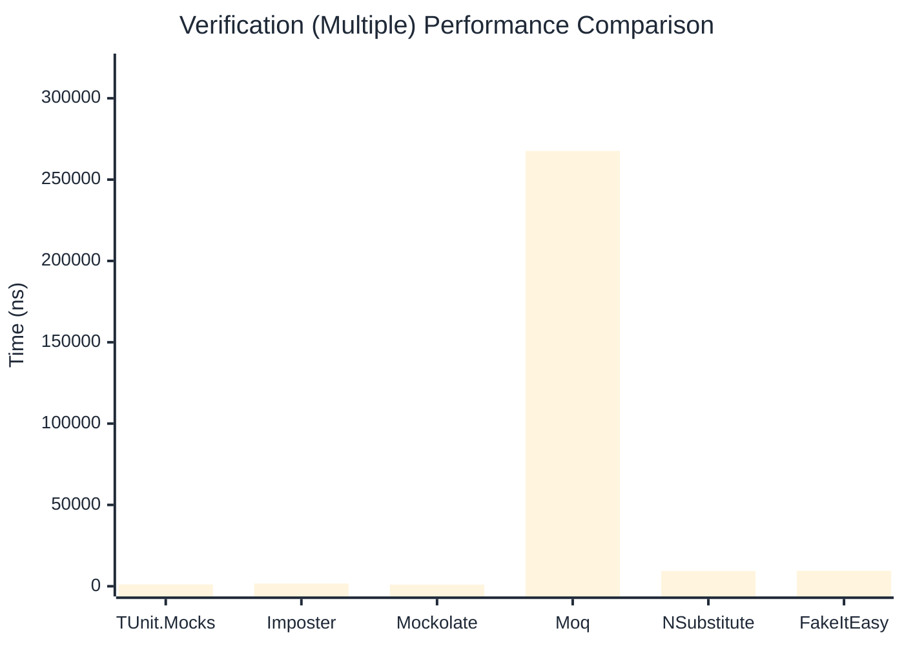

# Verification Benchmark

> Verifying mock method calls — comparing **TUnit.Mocks** (source-generated) against runtime proxy-based mocking libraries.

:::info Last Updated
This benchmark was automatically generated on **2026-10-11** from the latest CI run.

**Environment:** Ubuntu Latest • .NET SDK 10.0.401
:::

## 📊 Results

Verifying mock method calls:

| Library | Mean | Error | StdDev | Allocated |
|---------|------|-------|--------|-----------|
| **TUnit.Mocks** | 705.09 ns | 6.908 ns | 5.769 ns | 3024 B |
| Imposter | 586.30 ns | 11.749 ns | 12.572 ns | 4664 B |
| Mockolate | 337.99 ns | 2.845 ns | 2.661 ns | 2128 B |
| Moq | 192,834.73 ns | 2,217.532 ns | 1,851.739 ns | 24324 B |
| NSubstitute | 5,505.05 ns | 43.261 ns | 38.350 ns | 10064 B |
| FakeItEasy | 5,976.52 ns | 40.047 ns | 33.441 ns | 10722 B |

---

### Never

| Library | Mean | Error | StdDev | Allocated |
|---------|------|-------|--------|-----------|
| **TUnit.Mocks** | 45.03 ns | 0.413 ns | 0.345 ns | 320 B |
| Imposter | 291.43 ns | 5.676 ns | 5.309 ns | 2384 B |
| Mockolate | 199.60 ns | 1.551 ns | 1.295 ns | 1144 B |
| Moq | 48,091.90 ns | 425.001 ns | 354.895 ns | 6925 B |
| NSubstitute | 3,132.85 ns | 14.639 ns | 12.977 ns | 7088 B |
| FakeItEasy | 2,781.10 ns | 16.043 ns | 14.222 ns | 5210 B |

---

### Multiple

| Library | Mean | Error | StdDev | Allocated |
|---------|------|-------|--------|-----------|
| **TUnit.Mocks** | 1,101.59 ns | 6.233 ns | 5.205 ns | 4512 B |
| Imposter | 1,655.42 ns | 25.498 ns | 22.603 ns | 11144 B |
| Mockolate | 945.20 ns | 18.629 ns | 27.883 ns | 5240 B |
| Moq | 267,633.17 ns | 1,988.264 ns | 1,552.306 ns | 34810 B |
| NSubstitute | 9,368.30 ns | 125.093 ns | 117.012 ns | 16763 B |
| FakeItEasy | 9,486.26 ns | 188.209 ns | 193.277 ns | 19232 B |

## 🎯 Key Insights

This benchmark compares **TUnit.Mocks** (source-generated) against runtime proxy-based mocking libraries for verifying mock method calls.

---

:::note Methodology
View the [mock benchmarks overview](/docs/benchmarks/mocks) for methodology details and environment information.
:::

*Last generated: 2026-10-11T02:43:35.245Z*
