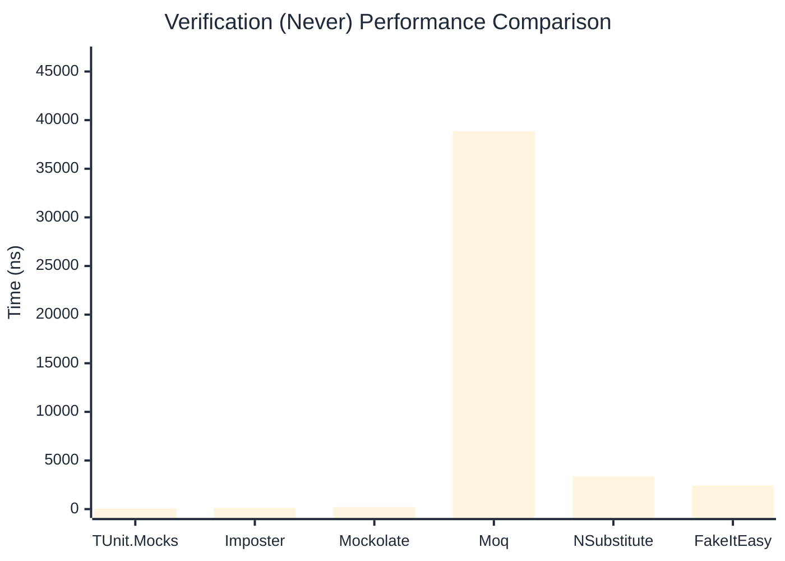

# Verification Benchmark

> Verifying mock method calls — comparing **TUnit.Mocks** (source-generated) against runtime proxy-based mocking libraries.

:::info Last Updated
This benchmark was automatically generated on **2026-11-08** from the latest CI run.

**Environment:** Ubuntu Latest • .NET SDK 10.0.403
:::

## 📊 Results

Verifying mock method calls:

| Library | Mean | Error | StdDev | Allocated |
|---------|------|-------|--------|-----------|
| **TUnit.Mocks** | 662.20 ns | 7.199 ns | 6.734 ns | 3040 B |
| Imposter | 277.31 ns | 5.483 ns | 5.129 ns | 1104 B |
| Mockolate | 387.27 ns | 7.690 ns | 10.780 ns | 2128 B |
| Moq | 150,225.12 ns | 781.845 ns | 731.338 ns | 24577 B |
| NSubstitute | 5,801.47 ns | 58.687 ns | 49.007 ns | 10064 B |
| FakeItEasy | 4,829.90 ns | 82.895 ns | 77.540 ns | 10717 B |

---

### Never

| Library | Mean | Error | StdDev | Allocated |
|---------|------|-------|--------|-----------|
| **TUnit.Mocks** | 47.23 ns | 0.595 ns | 0.528 ns | 336 B |
| Imposter | 123.07 ns | 2.051 ns | 1.818 ns | 616 B |
| Mockolate | 213.59 ns | 4.307 ns | 4.422 ns | 1144 B |
| Moq | 38,875.10 ns | 575.164 ns | 538.009 ns | 6922 B |
| NSubstitute | 3,351.63 ns | 20.663 ns | 19.328 ns | 7088 B |
| FakeItEasy | 2,446.15 ns | 18.564 ns | 16.456 ns | 5209 B |

---

### Multiple

| Library | Mean | Error | StdDev | Allocated |
|---------|------|-------|--------|-----------|
| **TUnit.Mocks** | 1,198.15 ns | 21.068 ns | 22.542 ns | 4528 B |
| Imposter | 544.14 ns | 10.825 ns | 11.583 ns | 2304 B |
| Mockolate | 977.90 ns | 18.892 ns | 23.892 ns | 5240 B |
| Moq | 195,313.79 ns | 457.088 ns | 405.196 ns | 34584 B |
| NSubstitute | 10,388.04 ns | 44.380 ns | 41.513 ns | 16889 B |
| FakeItEasy | 8,756.43 ns | 99.205 ns | 92.796 ns | 19238 B |

## 🎯 Key Insights

This benchmark compares **TUnit.Mocks** (source-generated) against runtime proxy-based mocking libraries for verifying mock method calls.

---

:::note Methodology
View the [mock benchmarks overview](/docs/benchmarks/mocks) for methodology details and environment information.
:::

*Last generated: 2026-11-08T02:26:36.812Z*
