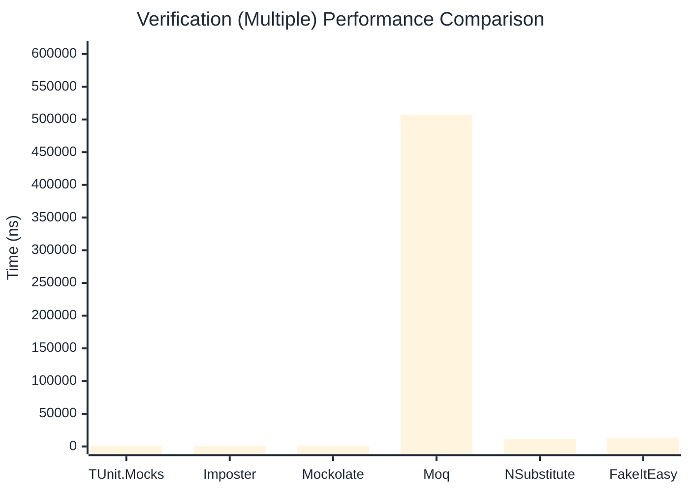

# Verification Benchmark

> Verifying mock method calls — comparing **TUnit.Mocks** (source-generated) against runtime proxy-based mocking libraries.

:::info Last Updated
This benchmark was automatically generated on **2026-11-11** from the latest CI run.

**Environment:** Ubuntu Latest • .NET SDK 11.0.100
:::

## 📊 Results

Verifying mock method calls:

| Library | Mean | Error | StdDev | Allocated |
|---------|------|-------|--------|-----------|
| **TUnit.Mocks** | 710.72 ns | 5.279 ns | 4.938 ns | 3040 B |
| Imposter | 250.47 ns | 4.382 ns | 4.099 ns | 1096 B |
| Mockolate | 375.17 ns | 3.433 ns | 3.211 ns | 2088 B |
| Moq | 375,086.38 ns | 2,398.522 ns | 2,002.875 ns | 24300 B |
| NSubstitute | 6,731.82 ns | 71.225 ns | 63.139 ns | 10024 B |
| FakeItEasy | 6,953.50 ns | 88.006 ns | 82.320 ns | 10506 B |

---

### Never

| Library | Mean | Error | StdDev | Allocated |
|---------|------|-------|--------|-----------|
| **TUnit.Mocks** | 50.42 ns | 0.359 ns | 0.336 ns | 336 B |
| Imposter | 124.99 ns | 1.414 ns | 1.181 ns | 616 B |
| Mockolate | 211.85 ns | 2.467 ns | 2.308 ns | 1096 B |
| Moq | 94,328.37 ns | 470.108 ns | 439.740 ns | 6917 B |
| NSubstitute | 3,697.97 ns | 23.684 ns | 20.995 ns | 7056 B |
| FakeItEasy | 3,438.71 ns | 19.166 ns | 16.005 ns | 5105 B |

---

### Multiple

| Library | Mean | Error | StdDev | Allocated |
|---------|------|-------|--------|-----------|
| **TUnit.Mocks** | 1,178.44 ns | 12.587 ns | 11.774 ns | 4528 B |
| Imposter | 530.00 ns | 5.430 ns | 4.814 ns | 2288 B |
| Mockolate | 1,009.79 ns | 8.692 ns | 7.705 ns | 5128 B |
| Moq | 506,881.84 ns | 2,626.766 ns | 2,457.079 ns | 34890 B |
| NSubstitute | 11,822.89 ns | 72.522 ns | 60.559 ns | 16633 B |
| FakeItEasy | 12,891.79 ns | 75.965 ns | 71.057 ns | 18703 B |

## 🎯 Key Insights

This benchmark compares **TUnit.Mocks** (source-generated) against runtime proxy-based mocking libraries for verifying mock method calls.

---

:::note Methodology
View the [mock benchmarks overview](/docs/benchmarks/mocks) for methodology details and environment information.
:::

*Last generated: 2026-11-11T02:20:11.802Z*
