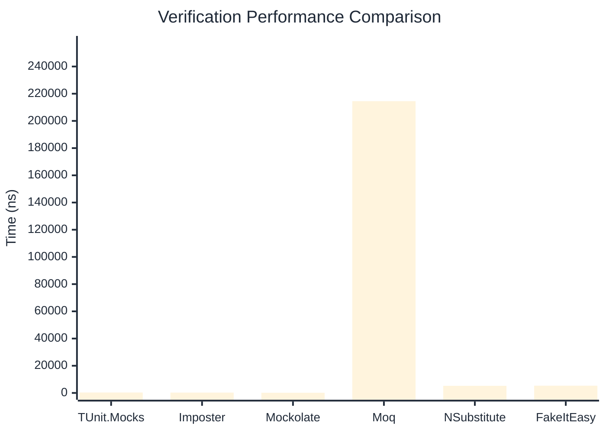
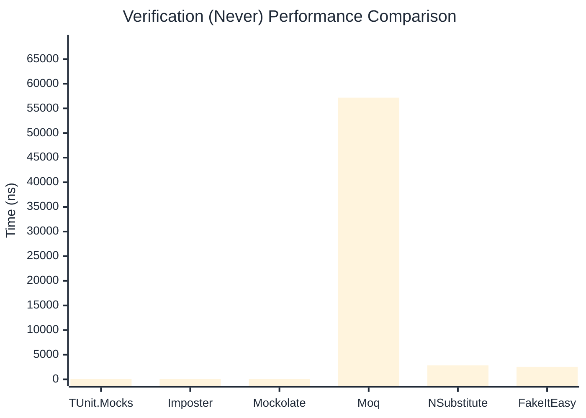

# Verification Benchmark

> Mock verification workflows, including creation, setup and invocation where applicable — comparing **TUnit.Mocks** (source-generated) against other source-generated and runtime proxy-based mocking libraries.

:::info Last Updated
This benchmark was automatically generated on **2026-11-22** from the latest CI run.

**Environment:** Ubuntu Latest • .NET SDK 11.0.100
:::

## 📊 Results

Mock verification workflows, including creation, setup and invocation where applicable:

| Library | Mean | Error | StdDev | Allocated |
|---------|------|-------|--------|-----------|
| **TUnit.Mocks** | 327.49 ns | 5.227 ns | 4.890 ns | 1512 B |
| Imposter | 267.50 ns | 5.219 ns | 6.601 ns | 1096 B |
| Mockolate | 148.38 ns | 2.658 ns | 2.487 ns | 712 B |
| Moq | 214,518.48 ns | 2,385.813 ns | 2,114.961 ns | 24316 B |
| NSubstitute | 5,263.41 ns | 101.994 ns | 95.405 ns | 10024 B |
| FakeItEasy | 5,339.65 ns | 105.800 ns | 190.780 ns | 10506 B |

---

### Never

| Library | Mean | Error | StdDev | Allocated |
|---------|------|-------|--------|-----------|
| **TUnit.Mocks** | 46.65 ns | 0.927 ns | 1.205 ns | 360 B |
| Imposter | 118.47 ns | 2.018 ns | 1.789 ns | 616 B |
| Mockolate | 59.76 ns | 1.136 ns | 1.115 ns | 368 B |
| Moq | 57,175.69 ns | 1,015.760 ns | 900.445 ns | 6917 B |
| NSubstitute | 2,827.46 ns | 56.507 ns | 130.962 ns | 7056 B |
| FakeItEasy | 2,523.17 ns | 46.586 ns | 43.576 ns | 5105 B |

---

### Multiple

| Library | Mean | Error | StdDev | Allocated |
|---------|------|-------|--------|-----------|
| **TUnit.Mocks** | 597.48 ns | 3.503 ns | 2.925 ns | 2528 B |
| Imposter | 502.68 ns | 9.735 ns | 14.571 ns | 2288 B |
| Mockolate | 317.70 ns | 6.242 ns | 7.666 ns | 1360 B |
| Moq | 302,000.19 ns | 1,788.356 ns | 1,672.829 ns | 34890 B |
| NSubstitute | 8,935.32 ns | 114.514 ns | 107.117 ns | 16745 B |
| FakeItEasy | 9,128.87 ns | 181.649 ns | 194.362 ns | 18703 B |

## 🎯 Key Insights

This benchmark compares **TUnit.Mocks** (source-generated) against other source-generated and runtime proxy-based mocking libraries for mock verification workflows, including creation, setup and invocation where applicable.

---

:::note Methodology
View the [mock benchmarks overview](/docs/benchmarks/mocks) for methodology details and environment information.
:::

*Last generated: 2026-11-22T02:21:53.323Z*
