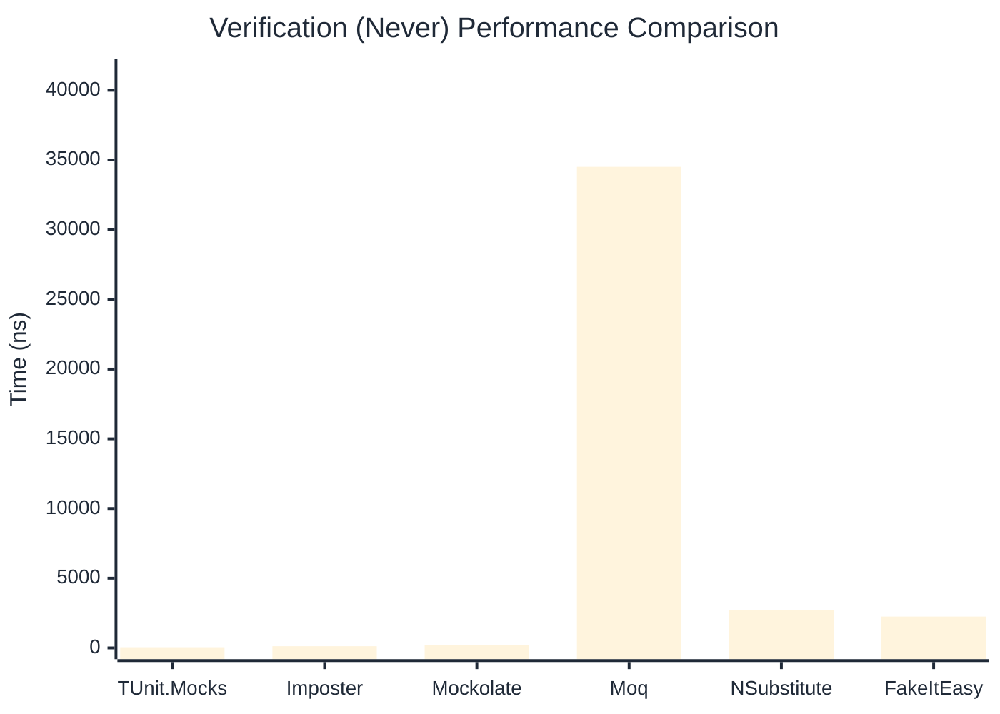

# Verification Benchmark

> Verifying mock method calls — comparing **TUnit.Mocks** (source-generated) against other source-generated and runtime proxy-based mocking libraries.

:::info Last Updated
This benchmark was automatically generated on **2026-11-19** from the latest CI run.

**Environment:** Ubuntu Latest • .NET SDK 11.0.100
:::

## 📊 Results

Verifying mock method calls:

| Library | Mean | Error | StdDev | Allocated |
|---------|------|-------|--------|-----------|
| **TUnit.Mocks** | 696.74 ns | 9.270 ns | 8.218 ns | 3040 B |
| Imposter | 263.66 ns | 4.764 ns | 4.223 ns | 1096 B |
| Mockolate | 383.15 ns | 7.353 ns | 7.221 ns | 1824 B |
| Moq | 140,766.88 ns | 965.655 ns | 903.274 ns | 24314 B |
| NSubstitute | 5,324.56 ns | 15.183 ns | 12.678 ns | 10024 B |
| FakeItEasy | 4,405.16 ns | 34.017 ns | 30.155 ns | 10501 B |

---

### Never

| Library | Mean | Error | StdDev | Allocated |
|---------|------|-------|--------|-----------|
| **TUnit.Mocks** | 48.07 ns | 0.950 ns | 1.785 ns | 336 B |
| Imposter | 121.66 ns | 2.428 ns | 4.057 ns | 616 B |
| Mockolate | 193.83 ns | 3.821 ns | 6.278 ns | 1040 B |
| Moq | 34,507.62 ns | 100.041 ns | 93.579 ns | 6914 B |
| NSubstitute | 2,702.42 ns | 51.556 ns | 52.944 ns | 7056 B |
| FakeItEasy | 2,247.64 ns | 35.351 ns | 33.067 ns | 5118 B |

---

### Multiple

| Library | Mean | Error | StdDev | Allocated |
|---------|------|-------|--------|-----------|
| **TUnit.Mocks** | 1,082.73 ns | 12.002 ns | 11.227 ns | 4528 B |
| Imposter | 494.73 ns | 9.604 ns | 14.375 ns | 2288 B |
| Mockolate | 709.00 ns | 8.153 ns | 7.626 ns | 3264 B |
| Moq | 185,883.74 ns | 649.147 ns | 575.452 ns | 34847 B |
| NSubstitute | 8,776.33 ns | 172.019 ns | 217.549 ns | 16633 B |
| FakeItEasy | 7,643.17 ns | 150.385 ns | 190.188 ns | 18716 B |

## 🎯 Key Insights

This benchmark compares **TUnit.Mocks** (source-generated) against other source-generated and runtime proxy-based mocking libraries for verifying mock method calls.

---

:::note Methodology
View the [mock benchmarks overview](/docs/benchmarks/mocks) for methodology details and environment information.
:::

*Last generated: 2026-11-19T02:23:19.275Z*
