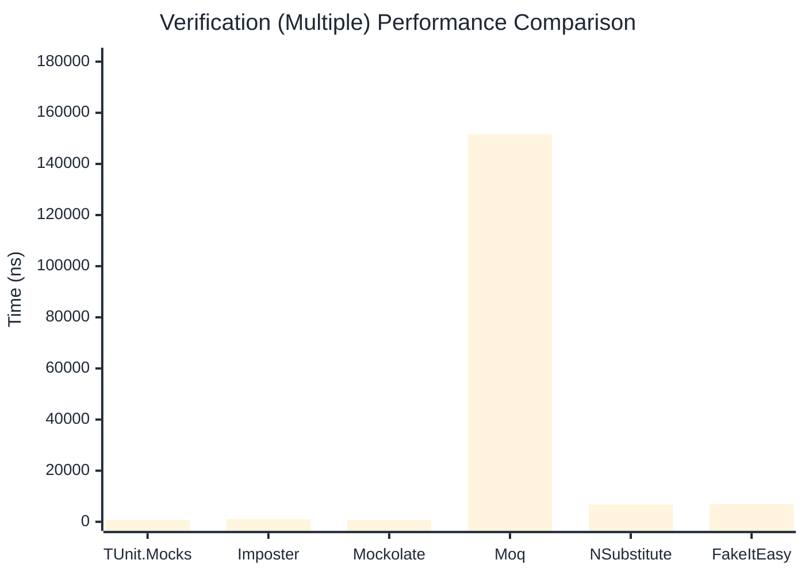

# Verification Benchmark

> Verifying mock method calls — comparing **TUnit.Mocks** (source-generated) against runtime proxy-based mocking libraries.

:::info Last Updated
This benchmark was automatically generated on **2026-10-25** from the latest CI run.

**Environment:** Ubuntu Latest • .NET SDK 10.0.402
:::

## 📊 Results

Verifying mock method calls:

| Library | Mean | Error | StdDev | Allocated |
|---------|------|-------|--------|-----------|
| **TUnit.Mocks** | 484.61 ns | 6.538 ns | 6.115 ns | 3040 B |
| Imposter | 418.23 ns | 8.353 ns | 9.943 ns | 4504 B |
| Mockolate | 274.48 ns | 3.668 ns | 3.063 ns | 2128 B |
| Moq | 112,296.19 ns | 979.064 ns | 867.914 ns | 24340 B |
| NSubstitute | 3,737.67 ns | 40.247 ns | 35.678 ns | 10064 B |
| FakeItEasy | 3,979.71 ns | 44.725 ns | 41.836 ns | 10722 B |

---

### Never

| Library | Mean | Error | StdDev | Allocated |
|---------|------|-------|--------|-----------|
| **TUnit.Mocks** | 37.98 ns | 0.653 ns | 0.578 ns | 336 B |
| Imposter | 193.69 ns | 3.868 ns | 10.325 ns | 2360 B |
| Mockolate | 157.89 ns | 3.158 ns | 5.774 ns | 1144 B |
| Moq | 27,169.55 ns | 356.267 ns | 333.252 ns | 6925 B |
| NSubstitute | 2,132.31 ns | 40.257 ns | 37.657 ns | 7088 B |
| FakeItEasy | 2,098.55 ns | 41.240 ns | 59.145 ns | 5322 B |

---

### Multiple

| Library | Mean | Error | StdDev | Allocated |
|---------|------|-------|--------|-----------|
| **TUnit.Mocks** | 810.65 ns | 15.166 ns | 12.665 ns | 4528 B |
| Imposter | 1,019.41 ns | 20.338 ns | 19.975 ns | 10760 B |
| Mockolate | 697.51 ns | 13.970 ns | 20.910 ns | 5240 B |
| Moq | 151,573.60 ns | 1,975.607 ns | 1,649.721 ns | 34698 B |
| NSubstitute | 6,773.25 ns | 87.585 ns | 81.928 ns | 16763 B |
| FakeItEasy | 6,865.45 ns | 126.189 ns | 118.037 ns | 19232 B |

## 🎯 Key Insights

This benchmark compares **TUnit.Mocks** (source-generated) against runtime proxy-based mocking libraries for verifying mock method calls.

---

:::note Methodology
View the [mock benchmarks overview](/docs/benchmarks/mocks) for methodology details and environment information.
:::

*Last generated: 2026-10-25T02:33:24.276Z*
