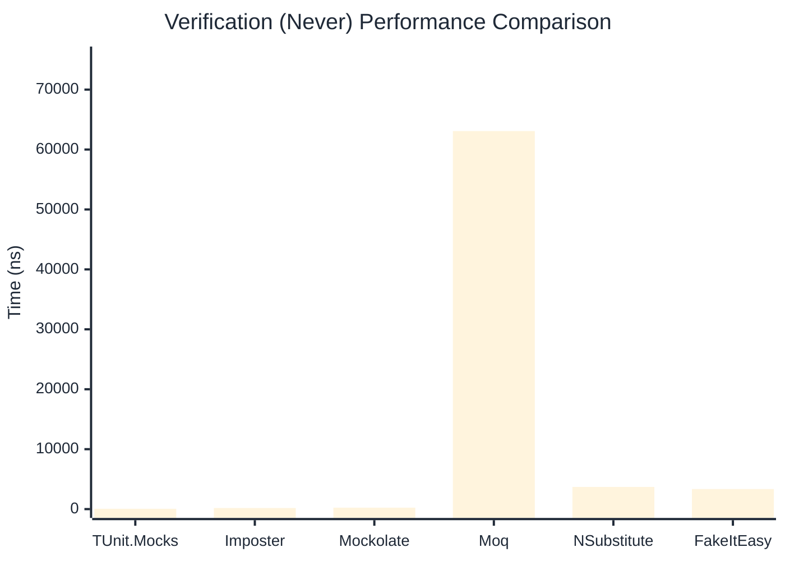

# Verification Benchmark

> Verifying mock method calls — comparing **TUnit.Mocks** (source-generated) against runtime proxy-based mocking libraries.

:::info Last Updated
This benchmark was automatically generated on **2026-11-01** from the latest CI run.

**Environment:** Ubuntu Latest • .NET SDK 10.0.403
:::

## 📊 Results

Verifying mock method calls:

| Library | Mean | Error | StdDev | Allocated |
|---------|------|-------|--------|-----------|
| **TUnit.Mocks** | 777.77 ns | 10.496 ns | 9.818 ns | 3040 B |
| Imposter | 366.14 ns | 3.211 ns | 3.003 ns | 1344 B |
| Mockolate | 400.77 ns | 1.828 ns | 1.710 ns | 2128 B |
| Moq | 253,121.40 ns | 1,732.163 ns | 1,620.266 ns | 24324 B |
| NSubstitute | 6,612.57 ns | 126.120 ns | 117.973 ns | 10064 B |
| FakeItEasy | 6,566.35 ns | 84.054 ns | 78.624 ns | 10722 B |

---

### Never

| Library | Mean | Error | StdDev | Allocated |
|---------|------|-------|--------|-----------|
| **TUnit.Mocks** | 56.90 ns | 0.247 ns | 0.231 ns | 336 B |
| Imposter | 182.56 ns | 0.976 ns | 0.865 ns | 760 B |
| Mockolate | 244.02 ns | 2.596 ns | 2.428 ns | 1144 B |
| Moq | 63,082.10 ns | 242.056 ns | 214.576 ns | 6925 B |
| NSubstitute | 3,701.95 ns | 41.435 ns | 38.758 ns | 7088 B |
| FakeItEasy | 3,347.70 ns | 44.246 ns | 41.387 ns | 5210 B |

---

### Multiple

| Library | Mean | Error | StdDev | Allocated |
|---------|------|-------|--------|-----------|
| **TUnit.Mocks** | 1,289.65 ns | 6.220 ns | 5.514 ns | 4528 B |
| Imposter | 820.58 ns | 5.553 ns | 4.922 ns | 2840 B |
| Mockolate | 1,123.51 ns | 19.064 ns | 17.833 ns | 5240 B |
| Moq | 357,904.59 ns | 2,433.087 ns | 2,031.738 ns | 34699 B |
| NSubstitute | 11,547.05 ns | 222.965 ns | 208.561 ns | 16762 B |
| FakeItEasy | 11,783.62 ns | 168.756 ns | 157.855 ns | 19232 B |

## 🎯 Key Insights

This benchmark compares **TUnit.Mocks** (source-generated) against runtime proxy-based mocking libraries for verifying mock method calls.

---

:::note Methodology
View the [mock benchmarks overview](/docs/benchmarks/mocks) for methodology details and environment information.
:::

*Last generated: 2026-11-01T02:27:32.250Z*
