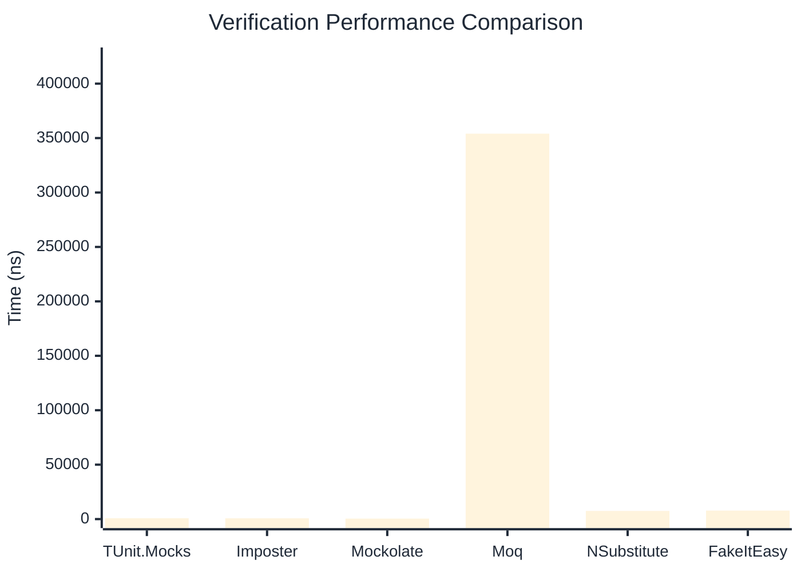
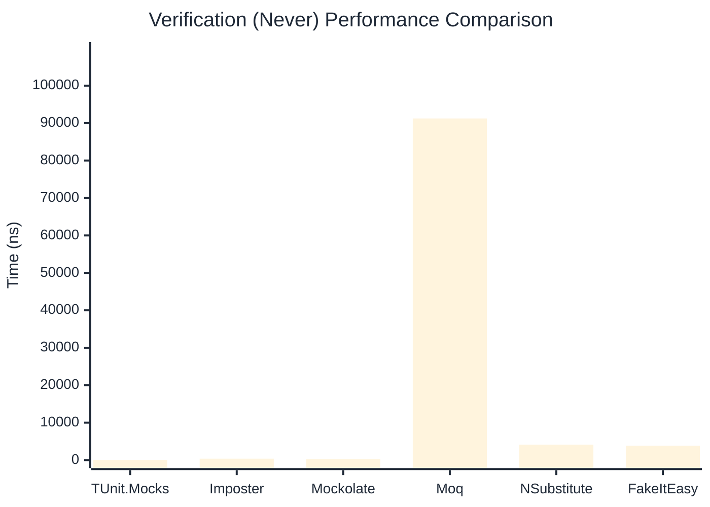
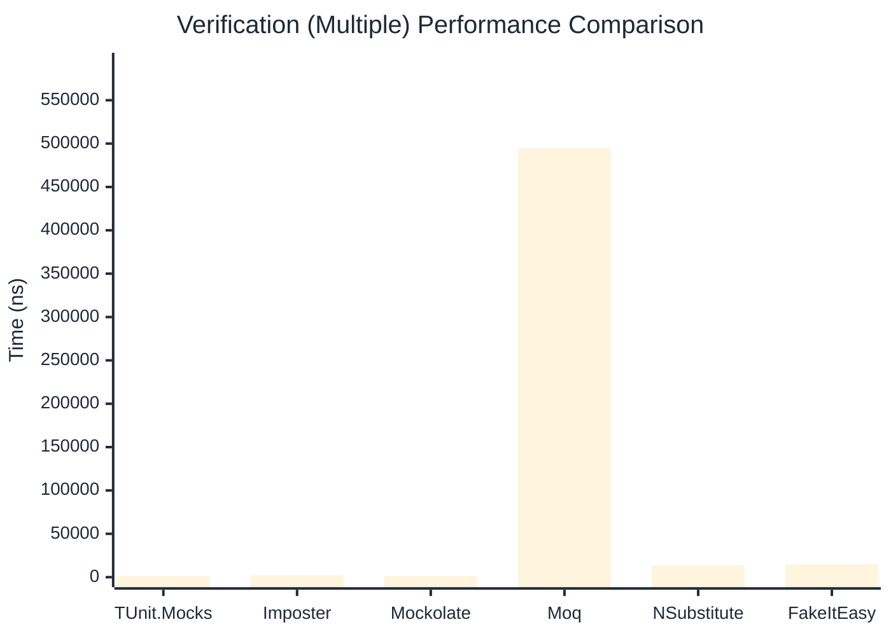

# Verification Benchmark

> Verifying mock method calls — comparing **TUnit.Mocks** (source-generated) against runtime proxy-based mocking libraries.

:::info Last Updated
This benchmark was automatically generated on **2026-10-22** from the latest CI run.

**Environment:** Ubuntu Latest • .NET SDK 10.0.402
:::

## 📊 Results

Verifying mock method calls:

| Library | Mean | Error | StdDev | Allocated |
|---------|------|-------|--------|-----------|
| **TUnit.Mocks** | 784.51 ns | 7.317 ns | 6.845 ns | 3040 B |
| Imposter | 713.79 ns | 8.483 ns | 7.520 ns | 4504 B |
| Mockolate | 455.47 ns | 6.621 ns | 6.194 ns | 2128 B |
| Moq | 354,080.47 ns | 2,810.370 ns | 2,628.822 ns | 24325 B |
| NSubstitute | 7,492.80 ns | 124.610 ns | 116.560 ns | 10064 B |
| FakeItEasy | 7,803.13 ns | 43.195 ns | 38.291 ns | 10722 B |

---

### Never

| Library | Mean | Error | StdDev | Allocated |
|---------|------|-------|--------|-----------|
| **TUnit.Mocks** | 60.75 ns | 0.953 ns | 0.891 ns | 336 B |
| Imposter | 382.44 ns | 4.147 ns | 3.463 ns | 2360 B |
| Mockolate | 276.54 ns | 2.140 ns | 1.897 ns | 1144 B |
| Moq | 91,238.09 ns | 189.356 ns | 158.121 ns | 6918 B |
| NSubstitute | 4,133.15 ns | 22.649 ns | 20.078 ns | 7088 B |
| FakeItEasy | 3,847.22 ns | 22.033 ns | 18.398 ns | 5210 B |

---

### Multiple

| Library | Mean | Error | StdDev | Allocated |
|---------|------|-------|--------|-----------|
| **TUnit.Mocks** | 1,398.58 ns | 7.204 ns | 6.739 ns | 4528 B |
| Imposter | 2,001.89 ns | 33.147 ns | 31.006 ns | 10760 B |
| Mockolate | 1,349.58 ns | 16.457 ns | 15.394 ns | 5240 B |
| Moq | 494,239.58 ns | 4,137.458 ns | 3,870.181 ns | 34699 B |
| NSubstitute | 13,538.57 ns | 63.239 ns | 56.060 ns | 16763 B |
| FakeItEasy | 14,691.21 ns | 216.289 ns | 168.864 ns | 19457 B |

## 🎯 Key Insights

This benchmark compares **TUnit.Mocks** (source-generated) against runtime proxy-based mocking libraries for verifying mock method calls.

---

:::note Methodology
View the [mock benchmarks overview](/docs/benchmarks/mocks) for methodology details and environment information.
:::

*Last generated: 2026-10-22T02:34:37.393Z*
