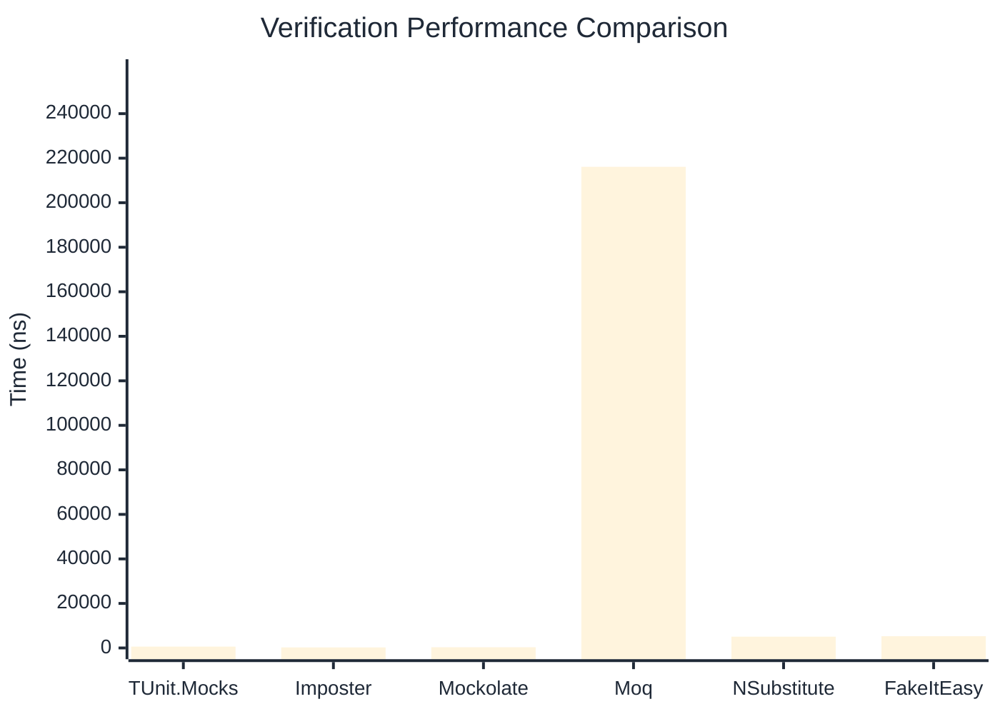
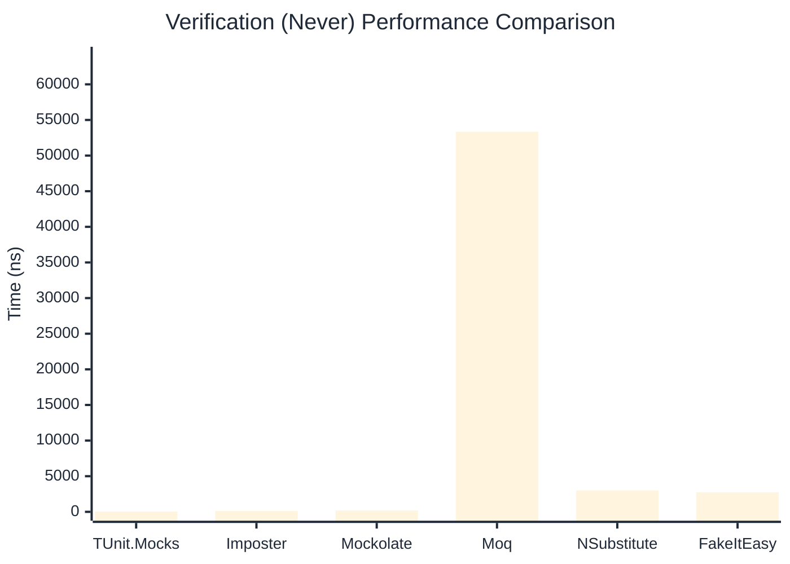
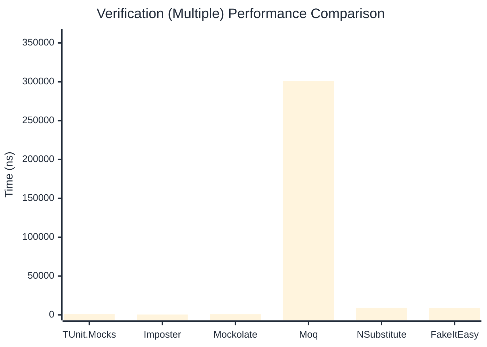

# Verification Benchmark

> Verifying mock method calls — comparing **TUnit.Mocks** (source-generated) against runtime proxy-based mocking libraries.

:::info Last Updated
This benchmark was automatically generated on **2026-11-14** from the latest CI run.

**Environment:** Ubuntu Latest • .NET SDK 11.0.100
:::

## 📊 Results

Verifying mock method calls:

| Library | Mean | Error | StdDev | Allocated |
|---------|------|-------|--------|-----------|
| **TUnit.Mocks** | 611.05 ns | 12.019 ns | 13.841 ns | 3040 B |
| Imposter | 232.90 ns | 3.573 ns | 3.168 ns | 1096 B |
| Mockolate | 320.26 ns | 6.129 ns | 6.812 ns | 2088 B |
| Moq | 216,122.59 ns | 1,147.035 ns | 1,016.817 ns | 24316 B |
| NSubstitute | 5,076.26 ns | 95.425 ns | 84.592 ns | 10024 B |
| FakeItEasy | 5,280.18 ns | 100.256 ns | 93.779 ns | 10506 B |

---

### Never

| Library | Mean | Error | StdDev | Allocated |
|---------|------|-------|--------|-----------|
| **TUnit.Mocks** | 42.84 ns | 0.425 ns | 0.376 ns | 336 B |
| Imposter | 112.29 ns | 1.159 ns | 1.028 ns | 616 B |
| Mockolate | 186.20 ns | 2.368 ns | 2.215 ns | 1096 B |
| Moq | 53,342.43 ns | 415.255 ns | 368.113 ns | 6917 B |
| NSubstitute | 2,991.24 ns | 23.535 ns | 22.015 ns | 7056 B |
| FakeItEasy | 2,750.62 ns | 50.993 ns | 45.204 ns | 5105 B |

---

### Multiple

| Library | Mean | Error | StdDev | Allocated |
|---------|------|-------|--------|-----------|
| **TUnit.Mocks** | 1,062.85 ns | 16.716 ns | 24.502 ns | 4528 B |
| Imposter | 479.49 ns | 9.519 ns | 9.776 ns | 2288 B |
| Mockolate | 928.29 ns | 17.998 ns | 23.403 ns | 5128 B |
| Moq | 300,940.04 ns | 1,484.944 ns | 1,239.996 ns | 34890 B |
| NSubstitute | 9,187.11 ns | 65.485 ns | 54.683 ns | 16633 B |
| FakeItEasy | 9,104.57 ns | 142.199 ns | 139.658 ns | 18703 B |

## 🎯 Key Insights

This benchmark compares **TUnit.Mocks** (source-generated) against runtime proxy-based mocking libraries for verifying mock method calls.

---

:::note Methodology
View the [mock benchmarks overview](/docs/benchmarks/mocks) for methodology details and environment information.
:::

*Last generated: 2026-11-14T02:21:36.343Z*
