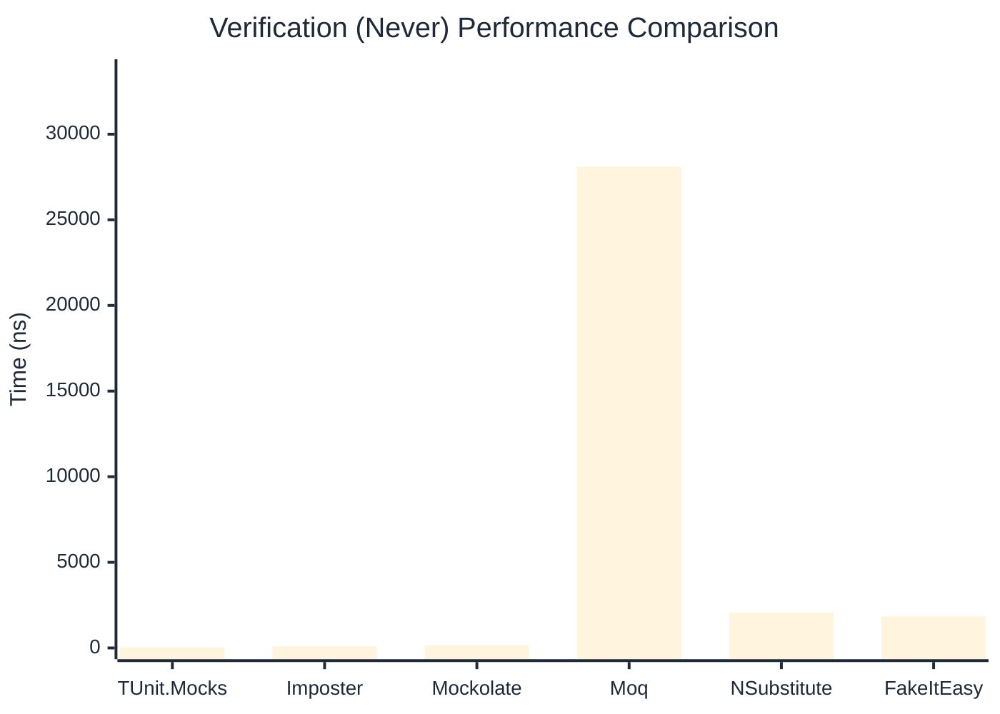

# Verification Benchmark

> Verifying mock method calls — comparing **TUnit.Mocks** (source-generated) against runtime proxy-based mocking libraries.

:::info Last Updated
This benchmark was automatically generated on **2026-11-06** from the latest CI run.

**Environment:** Ubuntu Latest • .NET SDK 10.0.403
:::

## 📊 Results

Verifying mock method calls:

| Library | Mean | Error | StdDev | Allocated |
|---------|------|-------|--------|-----------|
| **TUnit.Mocks** | 442.99 ns | 8.795 ns | 8.227 ns | 3040 B |
| Imposter | 176.78 ns | 3.523 ns | 3.916 ns | 1104 B |
| Mockolate | 251.23 ns | 4.980 ns | 10.504 ns | 2128 B |
| Moq | 106,019.86 ns | 2,037.132 ns | 2,091.984 ns | 24340 B |
| NSubstitute | 3,605.16 ns | 70.565 ns | 75.504 ns | 10176 B |
| FakeItEasy | 3,809.14 ns | 74.501 ns | 111.509 ns | 10722 B |

---

### Never

| Library | Mean | Error | StdDev | Allocated |
|---------|------|-------|--------|-----------|
| **TUnit.Mocks** | 35.26 ns | 0.710 ns | 0.729 ns | 336 B |
| Imposter | 88.05 ns | 1.643 ns | 1.457 ns | 616 B |
| Mockolate | 161.78 ns | 2.800 ns | 4.360 ns | 1144 B |
| Moq | 28,094.18 ns | 383.232 ns | 358.476 ns | 6925 B |
| NSubstitute | 2,066.26 ns | 39.881 ns | 33.302 ns | 7088 B |
| FakeItEasy | 1,842.57 ns | 17.691 ns | 16.548 ns | 5210 B |

---

### Multiple

| Library | Mean | Error | StdDev | Allocated |
|---------|------|-------|--------|-----------|
| **TUnit.Mocks** | 758.88 ns | 14.799 ns | 21.692 ns | 4528 B |
| Imposter | 350.33 ns | 3.022 ns | 2.523 ns | 2304 B |
| Mockolate | 648.60 ns | 5.991 ns | 5.003 ns | 5240 B |
| Moq | 147,940.55 ns | 2,848.287 ns | 2,924.981 ns | 34698 B |
| NSubstitute | 6,511.22 ns | 60.996 ns | 47.622 ns | 16889 B |
| FakeItEasy | 6,430.40 ns | 127.071 ns | 141.239 ns | 19232 B |

## 🎯 Key Insights

This benchmark compares **TUnit.Mocks** (source-generated) against runtime proxy-based mocking libraries for verifying mock method calls.

---

:::note Methodology
View the [mock benchmarks overview](/docs/benchmarks/mocks) for methodology details and environment information.
:::

*Last generated: 2026-11-06T02:27:23.366Z*
