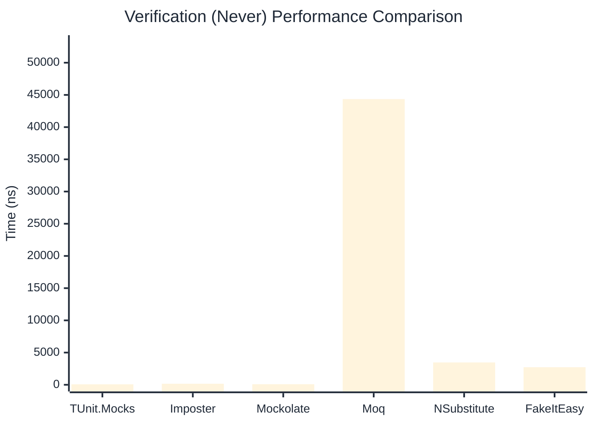
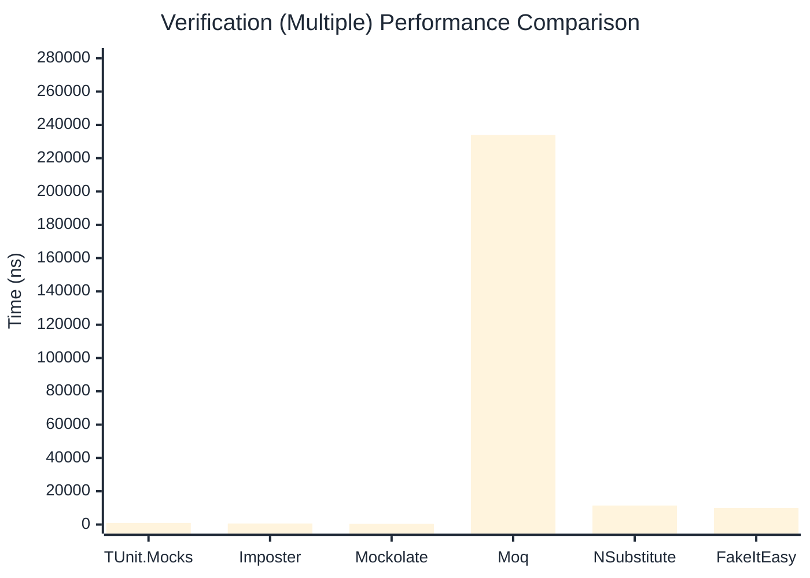

# Verification Benchmark

> Mock verification workflows, including creation, setup and invocation where applicable — comparing **TUnit.Mocks** (source-generated) against other source-generated and runtime proxy-based mocking libraries.

:::info Last Updated
This benchmark was automatically generated on **2026-11-24** from the latest CI run.

**Environment:** Ubuntu Latest • .NET SDK 11.0.100
:::

## 📊 Results

Mock verification workflows, including creation, setup and invocation where applicable:

| Library | Mean | Error | StdDev | Allocated |
|---------|------|-------|--------|-----------|
| **TUnit.Mocks** | 521.56 ns | 2.562 ns | 2.397 ns | 1512 B |
| Imposter | 321.04 ns | 2.988 ns | 2.795 ns | 1096 B |
| Mockolate | 293.43 ns | 1.440 ns | 1.277 ns | 712 B |
| Moq | 197,965.75 ns | 1,119.885 ns | 1,047.541 ns | 24314 B |
| NSubstitute | 6,705.43 ns | 34.369 ns | 32.149 ns | 10136 B |
| FakeItEasy | 5,539.69 ns | 25.593 ns | 22.688 ns | 10501 B |

---

### Never

| Library | Mean | Error | StdDev | Allocated |
|---------|------|-------|--------|-----------|
| **TUnit.Mocks** | 70.47 ns | 0.966 ns | 0.903 ns | 360 B |
| Imposter | 159.98 ns | 0.847 ns | 0.707 ns | 616 B |
| Mockolate | 84.98 ns | 0.716 ns | 0.669 ns | 368 B |
| Moq | 44,355.13 ns | 236.896 ns | 221.593 ns | 6914 B |
| NSubstitute | 3,472.16 ns | 6.826 ns | 5.700 ns | 7056 B |
| FakeItEasy | 2,727.11 ns | 21.654 ns | 18.082 ns | 5118 B |

---

### Multiple

| Library | Mean | Error | StdDev | Allocated |
|---------|------|-------|--------|-----------|
| **TUnit.Mocks** | 921.37 ns | 3.983 ns | 3.326 ns | 2528 B |
| Imposter | 646.11 ns | 4.191 ns | 3.920 ns | 2288 B |
| Mockolate | 481.52 ns | 2.987 ns | 2.794 ns | 1360 B |
| Moq | 233,898.61 ns | 1,180.720 ns | 1,104.446 ns | 34847 B |
| NSubstitute | 11,415.89 ns | 69.893 ns | 58.364 ns | 16633 B |
| FakeItEasy | 9,873.67 ns | 30.122 ns | 26.702 ns | 18715 B |

## 🎯 Key Insights

This benchmark compares **TUnit.Mocks** (source-generated) against other source-generated and runtime proxy-based mocking libraries for mock verification workflows, including creation, setup and invocation where applicable.

---

:::note Methodology
View the [mock benchmarks overview](/docs/benchmarks/mocks) for methodology details and environment information.
:::

*Last generated: 2026-11-24T02:20:52.556Z*
