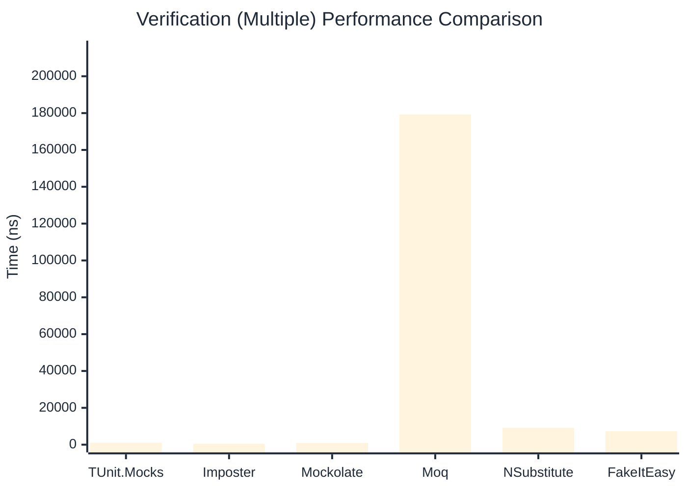

# Verification Benchmark

> Verifying mock method calls — comparing **TUnit.Mocks** (source-generated) against runtime proxy-based mocking libraries.

:::info Last Updated
This benchmark was automatically generated on **2026-11-15** from the latest CI run.

**Environment:** Ubuntu Latest • .NET SDK 11.0.100
:::

## 📊 Results

Verifying mock method calls:

| Library | Mean | Error | StdDev | Allocated |
|---------|------|-------|--------|-----------|
| **TUnit.Mocks** | 621.38 ns | 12.414 ns | 12.749 ns | 3040 B |
| Imposter | 243.12 ns | 4.670 ns | 4.369 ns | 1096 B |
| Mockolate | 366.88 ns | 5.480 ns | 4.858 ns | 2104 B |
| Moq | 137,125.86 ns | 966.444 ns | 856.728 ns | 24314 B |
| NSubstitute | 4,892.91 ns | 40.688 ns | 38.060 ns | 10024 B |
| FakeItEasy | 4,207.43 ns | 82.678 ns | 135.842 ns | 10501 B |

---

### Never

| Library | Mean | Error | StdDev | Allocated |
|---------|------|-------|--------|-----------|
| **TUnit.Mocks** | 46.49 ns | 0.918 ns | 1.631 ns | 336 B |
| Imposter | 120.55 ns | 2.399 ns | 4.623 ns | 616 B |
| Mockolate | 211.69 ns | 4.212 ns | 5.014 ns | 1104 B |
| Moq | 34,100.30 ns | 131.959 ns | 103.025 ns | 6914 B |
| NSubstitute | 2,691.96 ns | 42.473 ns | 39.729 ns | 7056 B |
| FakeItEasy | 2,214.39 ns | 43.023 ns | 47.820 ns | 5118 B |

---

### Multiple

| Library | Mean | Error | StdDev | Allocated |
|---------|------|-------|--------|-----------|
| **TUnit.Mocks** | 1,081.49 ns | 21.624 ns | 27.348 ns | 4528 B |
| Imposter | 488.06 ns | 9.637 ns | 18.796 ns | 2288 B |
| Mockolate | 912.48 ns | 18.212 ns | 47.012 ns | 5160 B |
| Moq | 179,246.96 ns | 616.872 ns | 577.022 ns | 34847 B |
| NSubstitute | 9,138.01 ns | 49.956 ns | 44.285 ns | 16744 B |
| FakeItEasy | 7,281.19 ns | 145.061 ns | 268.880 ns | 18795 B |

## 🎯 Key Insights

This benchmark compares **TUnit.Mocks** (source-generated) against runtime proxy-based mocking libraries for verifying mock method calls.

---

:::note Methodology
View the [mock benchmarks overview](/docs/benchmarks/mocks) for methodology details and environment information.
:::

*Last generated: 2026-11-15T02:24:17.223Z*
